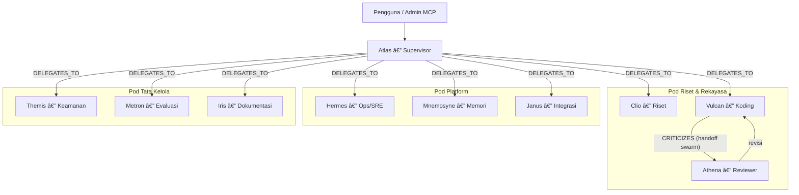
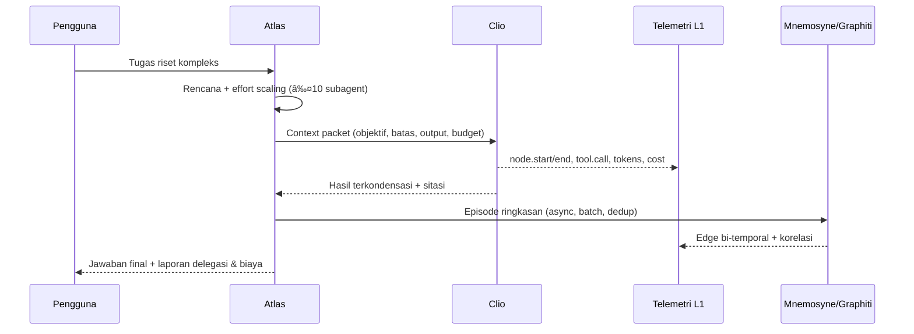

Ç‘# Makalah: Rancangan dan Tahap Implementasi 10 Subagent pada Enterprise LangGraph Platform (LGP v2.0)


| Info    | Nilai                                                                        |
| ------- | ---------------------------------------------------------------------------- |
| Versi   | 1.0                                                                          |
| Tanggal | 2026-10-08                                                                   |
| Status  | Draf untuk direview pemilik platform                                         |
| Basis   | Blueprint Arsitektur & Implementasi LGP v2.0 (dokumen internal pengguna) |
| Bahasa  | Indonesia                                                                    |


---

## 1. Pertanyaan (Tujuan Riset)

> Bagaimana merancang tim **10 subagent** yang lengkap, terkontrak, dan aman — mencakup riset, rekayasa perangkat lunak, operasional platform, dan tata kelola — di atas Enterprise LangGraph Platform (LGP v2.0), serta tahap implementasinya yang terpetakan ke rencana PR platform?

Ruang lingkup: rancangan kontrak per subagent (registry §6.2 blueprint), topologi orkestrasi, anggaran (budget) turun-temurun, guardrail keamanan, integrasi memori temporal Graphiti, matriks korelasi antar-subagent, dan tahap implementasi bertahap (Fase 0–7).

---

## 2. Ringkasan Eksekutif

1. **Arsitektur orchestrator–worker terbukti dan direkomendasikan.** Pola supervisor/delegasi yang dipakai Atlas (subagent koordinator) mengikuti pola yang dipakai sistem riset multi-agent produksi; tim lead + subagent paralel melampaui agen tunggal sebesar 90,2% pada evaluasi riset internal Anthropic ([Anthropic](search-result://ipBQXZcI)).
2. **Delegasi harus eksplisit.** Setiap context packet wajib memuat objektif, format output, tool yang boleh dipakai, dan batas tugas; tanpa itu subagent menduplikasi kerja atau meninggalkan celah ([Anthropic](search-result://ipBQXZcI)).
3. **10 subagent terbagi dalam 4 pod dengan tanggung jawab bersih**: Pod Koordinasi (Atlas), Pod Riset & Rekayasa (Clio, Vulcan, Athena), Pod Platform (Hermes, Mnemosyne, Janus), Pod Tata Kelola (Themis, Metron, Iris).
4. **Keamanan adalah batas desain, bukan tambalan.** Admin MCP tidak pernah dipasang ke subagent yang memproses konten eksternal tak tepercaya (Clio); semua grant tool per-node; semua aksi tulis lewat dry-run + approval gate.
5. **Skala usaha harus proporsional (effort scaling).** Aturan delegasi: 1 subagent untuk tugas sederhana, 2–4 untuk perbandingan, hingga maksimum 10 untuk riset kompleks ([Fountain City](search-result://T7XiZLNo)).
6. **Biaya multi-agent nyata (\~15× token vs chat biasa)** sehingga budget turun-temurun, circuit breaker, dan dedup memori bukan opsional ([Fountain City](search-result://T7XiZLNo)).
7. **Implementasi bertahap 8 fase (0–7)** terpetakan langsung ke PR #0–#15 blueprint plus 3 PR baru (#16–#18) khusus tim 10 subagent; setiap fase punya Definition of Done yang dapat diuji.

---

## 3. Metodologi

- **Sumber utama**: Blueprint LGP v2.0 milik pengguna (dokumen internal, 2026-10-08) — menjadi acuan arsitektur, kontrak registry, formula korelasi, dan rencana PR.
- **Sumber sekunder (publik)**: dokumentasi resmi LangChain, blog engineering Anthropic, repositori GitHub (langgraph-swarm, Graphiti), makalah arXiv tentang Zep/Graphiti, blog spesifikasi MCP, dan analisis komunitas. Dicari via web search, disilangkan minimal dua sumber untuk klaim penting.
- **Pendekatan**: sintesis per tema → rancangan kontrak per subagent → pemetaan ke tahap implementasi. Setiap keputusan ditelusuri ke prinsip blueprint (§1) atau ke sumber publik.
- **Limitasi**: (1) nama dan profil 10 subagent adalah proposal (belum ada daftar final dari pemilik); (2) angka budget adalah nilai awal yang dapat dikonfigurasi per workspace; (3) beberapa item platform masih berstatus \[VERIFIKASI\]/\[KONFIRMASI\] di blueprint dan dibawa turun ke daftar pertanyaan terbuka makalah ini.

---

## 4. Landasan Teknis (Temuan dari Literatur)

### 4.1 Pola orkestrasi: supervisor vs swarm

- Pola **supervisor**: koordinator pusat mengklasifikasikan intent dan merutekan ke spesialis; setiap interaksi melewati koordinator (\~2 panggilan LLM per domain) ([Focused.io](search-result://wnB5EGM3)).
- Pola **swarm**: agen saling oper kendali langsung via `Command(goto=...)` (\~1 panggilan LLM per domain setelah yang pertama) — lebih cepat, tetapi lebih rentan salah rute ([Focused.io](search-result://wnB5EGM3), [langgraph-swarm-py](search-result://ZuzJtWQy)).
- Dokumentasi resmi LangChain kini **merekomendasikan pola supervisor via tools** (bukan library `langgraph-supervisor`) untuk kontrol context engineering yang lebih baik ([LangChain Reference](search-result://ADAC1ahK)).
- **Keputusan untuk LGP**: Atlas memakai **supervisor via tools** sebagai default; handoff swarm (Vulcan→Athena) diizinkan untuk loop critic yang terbatas dan dicatat sebagai event telemetri `DELEGATES_TO`.

### 4.2 Pelajaran dari sistem riset multi-agent produksi

- Tim lead agent + subagent paralel mengungguli agen tunggal 90,2% pada eval riset internal; setiap subagent berjalan dengan context window sendiri dan berfungsi sebagai "filter cerdas" yang mengompres temuan ([Anthropic](search-result://ipBQXZcI)).
- Kontrak delegasi wajib memuat: objektif, format output, panduan tool/sumber, dan batas tugas yang eksplisit ([Anthropic](search-result://ipBQXZcI)).
- Biaya token \~15× percakapan biasa; kontrol effort-scaling diperlukan agar agen tidak mem-spawn subagent berlebihan untuk tugas sederhana ([Fountain City](search-result://T7XiZLNo)).

### 4.3 Memori temporal (Graphiti) untuk subagent

- Graphiti membangun knowledge graph temporal secara inkremental: fakta punya jendela validitas (`valid_at`/`invalid_at`), fakta lama di-invalidate (bukan dihapus), dan semuanya tertelusur ke episode sumber ([GitHub getzep/graphiti](search-result://EVMG8PIk), [Neo4j Blog](search-result://1kQ9cAkh)).
- Makalah Zep menunjukkan arsitektur graph temporal mengungguli baseline memori agen pada benchmark DMR, dengan penelusuran dua arah episode↔fakta untuk sitasi ([arXiv 2501.13956](search-result://lHqGEsqi)).
- **Implikasi**: memori 10 subagent memakai dua lapis (L1 telemetri tanpa LLM + L2 Graphiti async) sesuai §7.1 blueprint, dengan `group_id = {tenant}:{workspace}` dan sitasi episode di Neuron Graph.

### 4.4 MCP sebagai antarmuka kendali

- Tool annotations (`readOnlyHint`, `destructiveHint`, `idempotentHint`, `openWorldHint`) adalah kosakata risiko: klien dapat auto-approve tool read-only dari server tepercaya dan meminta konfirmasi untuk tool destruktif ([MCP Blog](search-result://9wSki8oV)).
- Praktik terbaik: set **semua annotation eksplisit di setiap tool** dan uji dengan `tools/list` terprogram ([sunpeak](search-result://feyB4J1n)).
- **Implikasi**: seluruh grant tool 10 subagent didefinisikan sebagai pasangan (server MCP, pola tool, annotations) dan divalidasi otomatis di CI (PR #6, #7, #16).

---

## 5. Rancangan Sistem: Tim 10 Subagent

### 5.1 Prinsip perancangan

1. **Satu koordinator, banyak spesialis** — Atlas satu-satunya yang boleh berdialog dengan pengguna dan mengelola context packet; subagent tidak saling berbicara kecuali handoff critic yang diizinkan.
2. **Context packet, bukan seluruh riwayat** — subagent menerima paket terkurasi (objektif, batas, format output, grant tool, budget tersisa) → menekan biaya dan kebocoran konteks.
3. **Effort scaling eksplisit** — 1 subagent untuk tugas sederhana; 2–4 untuk perbandingan; ≤10 untuk riset kompleks; aturan ini tertulis di prompt Atlas dan di enforcement runtime.
4. **Least privilege + pemisahan konteks tak tepercaya** — subagent yang memproses konten eksternal (Clio) TIDAK memperoleh Admin MCP; hanya tool outbound yang di-allowlist.
5. **Budget turun-temurun** — budget anak ≤ sisa budget induk; circuit breaker per subagent; deteksi loop via hash state berulang.
6. **Semua melalui platform** — semua panggilan LLM lewat model gateway; semua event ke Telemetry L1; semua memori jangka panjang ke Graphiti L2; semua aksi tulis ke platform lewat dry-run + idempotency-key.

### 5.2 Topologi tim



**Kontrak context packet (dipakai Atlas → semua subagent):**

```jsonc
{
  "packet_id": "pkt-…", "run_id": "r-…", "trace_id": "…",
  "objective": "…",                       // apa yang harus dicapai
  "boundaries": "…",                       // apa yang BUKAN tugasnya
  "output_format": { "schema_ref": "…" },  // kontrak output (Pydantic)
  "tool_grants": ["web.search@readonly", "github.read@readonly"],
  "budget": { "tokens": 300000, "usd": 1.5, "wall_clock_s": 900, "depth_left": 1 },
  "memory_hints": ["lgp_memory_search: proyek-X keputusan 2026-09"],
  "parent_check_ref": "ckpt-…"
}
```

### 5.3 Kontrak registry 10 subagent

Setiap subagent terdaftar di `subagent_registry` dengan kontrak lengkap (§6.2 blueprint). Nilai di bawah adalah **default konfigurabel per workspace**.

**Atlas — Supervisor (Pod Koordinasi)**


| Field           | Nilai                                                                                                                               |
| --------------- | ----------------------------------------------------------------------------------------------------------------------------------- |
| `id` / `role`   | `atlas` / orchestrator-supervisor                                                                                                   |
| Kapabilitas     | Dekomposisi tugas, delegasi, sintesis hasil, monitoring budget, eskalasi HITL                                                       |
| `input_schema`  | `{objective, constraints, context_refs[]}`                                                                                          |
| `output_schema` | `{final_answer, citations[], delegates_report[], cost_summary}`                                                                     |
| Grant MCP       | Admin MCP scope `runs:execute, graphs:read, state:read, memory:read/write, subagents:read`; TIDAK ada `admin:*`, TIDAK bisa approve |
| `model_policy`  | Model frontier (paling kuat) via gateway; extended thinking untuk rencana                                                           |
| Budget          | 1.500.000 token / $10 / 45 mnt / kedalaman delegasi ≤ 2 / langkah ≤ 60                                                              |
| `memory_scope`  | Store ns `(tenant, ws, user)` + Graphiti `group_id` penuh (baca)                                                                    |
| `trust_level`   | Tinggi (delegasi saja; aksi tulis tetap dry-run)                                                                                    |


**Clio — Riset & Sintesis (Pod Riset & Rekayasa)**


| Field          | Nilai                                                                                                                                 |
| -------------- | ------------------------------------------------------------------------------------------------------------------------------------- |
| `id` / `role`  | `clio` / deep-researcher                                                                                                              |
| Kapabilitas    | Web/news search, cross-check multi-sumber, sintesis dengan sitasi, deteksi konflik                                                    |
| Grant MCP      | **Hanya tool outbound**: `web_search`, `news_search`, `open_url` (read-only); **Admin MCP DILARANG** (konten eksternal tak tepercaya) |
| `model_policy` | Model menengah-andal; structured output wajib                                                                                         |
| Budget         | 300k token / $1,50 / 15 mnt / paralel ≤ 3 instansi per run                                                                            |
| `memory_scope` | Graphiti baca-semua, tulis hanya via ringkasan Atlas                                                                                  |
| `trust_level`  | Rendah (semua output diperiksa injection oleh tool-call guard)                                                                        |


**Vulcan — Rekayasa Perangkat Lunak (Pod Riset & Rekayasa)**


| Field          | Nilai                                                                                                                |
| -------------- | -------------------------------------------------------------------------------------------------------------------- |
| `id` / `role`  | `vulcan` / software-engineer                                                                                         |
| Kapabilitas    | Menulis kode graf/node, `lgp_graph_propose` + `lgp_graph_validate`, uji unit, patch dependensi                       |
| Grant MCP      | `graphs:write` (propose/validate SAJA — promote butuh approval manusia), `runs:execute` (dev), GitHub read/PR-create |
| `model_policy` | Model kuat untuk kode; eksekusi kode hanya di sandbox runner                                                         |
| Budget         | 400k token / $2,50 / 30 mnt / ≤ 5 iterasi revisi                                                                     |
| `memory_scope` | Store ns kode & proyek; Graphiti `ProjectArtifact`                                                               |
| `trust_level`  | Sedang (kode tidak pernah jalan aktif tanpa pipeline §4.4)                                                           |


**Athena — Reviewer/Critic (Pod Riset & Rekayasa)**


| Field          | Nilai                                                                                      |
| -------------- | ------------------------------------------------------------------------------------------ |
| `id` / `role`  | `athena` / critic-reviewer                                                                 |
| Kapabilitas    | Code review, review perubahan graf, adversarial QA, uji prompt-injection korpus            |
| Grant MCP      | Read-only: `lgp_graph_diff`, `lgp_graph_get_dag`, `lgp_audit_query`, `lgp_checkpoint_diff` |
| `model_policy` | Model kuat, mode adversarial; temperatur rendah                                            |
| Budget         | 200k token / $1,00 / 15 mnt / ≤ 3 putaran kritik                                           |
| `memory_scope` | Graphiti baca + tulis edge `CRITICIZES`                                                    |
| `trust_level`  | Sedang (hanya baca + menghasilkan laporan, tidak menulis kode)                             |


**Hermes — Platform Ops/SRE (Pod Platform)**


| Field          | Nilai                                                                                                  |
| -------------- | ------------------------------------------------------------------------------------------------------ |
| `id` / `role`  | `hermes` / platform-ops                                                                                |
| Kapabilitas    | Triage insiden, baca metrik/alert, `lgp_health`, usulkan runbook, verifikasi backup (via `lgp_health`) |
| Grant MCP      | Ops read-only + `lgp_schedule_create` (dry-run default); aksi remediasi → usulan ke manusia            |
| `model_policy` | Model menengah; terutama deterministik (query metrik)                                                  |
| Budget         | 150k token / $0,75 / 10 mnt                                                                            |
| `memory_scope` | Graphiti `SystemIncident`, `Decision`                                                                  |
| `trust_level`  | Sedang (proposal remediasi wajib approval)                                                             |


**Mnemosyne — Kurator Memori (Pod Platform)**


| Field          | Nilai                                                                                                                      |
| -------------- | -------------------------------------------------------------------------------------------------------------------------- |
| `id` / `role`  | `mnemosyne` / memory-curator                                                                                               |
| Kapabilitas    | Kurasi episode untuk ingest Graphiti, dedup hash, jaga ontologi (`PascalCase`/`SCREAMING_SNAKE_CASE`), penjelasan korelasi |
| Grant MCP      | `memory:read/write`, `lgp_memory_ingest`, `lgp_correlation_explain`                                                        |
| `model_policy` | Ekstraksi memakai model structured-output andal (model kecil kurang konsisten untuk ekstraksi)                             |
| Budget         | 250k token / $1,25 / 20 mnt + **anggaran ingest harian terpisah** (mis. 2M token/hari)                                     |
| `memory_scope` | Graphiti `group_id` penuh; redaksi PII sebelum ingest                                                                      |
| `trust_level`  | Sedang                                                                                                                     |


**Themis — Keamanan & Kepatuhan (Pod Tata Kelola)**


| Field          | Nilai                                                                                                     |
| -------------- | --------------------------------------------------------------------------------------------------------- |
| `id` / `role`  | `themis` / security-compliance                                                                            |
| Kapabilitas    | Analisis audit log, review grant RBAC, hygiene secret-ref, checklist UU PDP, review anotasi tool berisiko |
| Grant MCP      | `lgp_audit_query`, `lgp_secret_ref_list` (nama saja), read semua security endpoint                        |
| `model_policy` | Model kuat, mode audit; tidak pernah melihat nilai secret                                                 |
| Budget         | 150k token / $0,75 / 15 mnt                                                                               |
| `memory_scope` | Graphiti `Decision`, `SystemIncident`                                                                     |
| `trust_level`  | Sedang-tinggi untuk baca; tulis hanya laporan                                                             |


**Metron — Evaluasi & Data (Pod Tata Kelola)**


| Field          | Nilai                                                                                                   |
| -------------- | ------------------------------------------------------------------------------------------------------- |
| `id` / `role`  | `metron` / evaluation-data                                                                              |
| Kapabilitas    | Membangun dataset eval per subagent, menjalankan regresi, LLM-as-judge, analisis biaya/latensi/kualitas |
| Grant MCP      | `runs:execute` (eval lane), `lgp_usage_report`, evals API                                               |
| `model_policy` | Model menengah + judge terpisah (model berbeda dari yang diuji)                                         |
| Budget         | 200k token / $1,00 / 20 mnt / ≤ 3 eksperimen paralel                                                    |
| `memory_scope` | Store ns eval; Graphiti hasil eksperimen                                                                |
| `trust_level`  | Sedang                                                                                                  |


**Iris — Dokumentasi & Komunikasi (Pod Tata Kelola)**


| Field          | Nilai                                                                                            |
| -------------- | ------------------------------------------------------------------------------------------------ |
| `id` / `role`  | `iris` / documentation-writer                                                                    |
| Kapabilitas    | Makalah, PRD, runbook, changelog, ringkasan status, draft internal-comms                         |
| Grant MCP      | `graphs:read`, `runs:read`, `memory:read`; tulis artefak ke workspace (bukan ke platform config) |
| `model_policy` | Model menengah-kuat; gaya bahasa terkontrol template                                             |
| Budget         | 300k token / $1,50 / 25 mnt                                                                      |
| `memory_scope` | Graphiti `Document`, `ProjectArtifact`                                                           |
| `trust_level`  | Sedang                                                                                           |


**Janus — Integrasi & MCP Hub (Pod Platform)**


| Field          | Nilai                                                                                      |
| -------------- | ------------------------------------------------------------------------------------------ |
| `id` / `role`  | `janus` / integration-mcp-hub                                                              |
| Kapabilitas    | Registrasi/uji server MCP eksternal, usulan grant per-node, kelola webhook/trigger adapter |
| Grant MCP      | `mcp:manage` (register/test/disable — `lgp_mcp_grant_set` tetap approval-gated)            |
| `model_policy` | Model menengah; sebagian besar deterministik (health check)                                |
| Budget         | 150k token / $0,75 / 15 mnt                                                                |
| `memory_scope` | Graphiti `ExternalApi`, tool registry                                                      |
| `trust_level`  | Rendah-sedang (setiap server baru wajib pemindaian tool/skill sebelum aktif)               |


### 5.4 Guardrail & budget turun-temurun

- **Aturan inti**: `budget(anak) ≤ budget_tersisa(induk)` — dihitung per delegasi, ditegakkan runtime; pelanggaran → `budget_exceeded` → circuit breaker subagent mati untuk run itu.
- **Deteksi loop**: hash (state\_input, tool\_call) berulang ≥ 3 → interrupt ke HITL.
- **Effort scaling** (enforcement, bukan hanya prompt): Atlas meminta konfirmasi manusia bila ingin men-spawn > 4 subagent untuk satu tugas.
- **Paralelisme**: hanya Clio (≤3) dan Metron (≤3) yang boleh multi-instansi; lainnya singleton per run.
- **Korelasi L1 yang diharapkan** (bahan uji telemetri PR #9): ko-aktivasi tinggi Vulcan–Athena (`CRITICIZES`), Atlas–Clio (`DELEGATES_TO` tinggi), Hermes–Themis (insiden), Mnemosyne–Atlas (ringkasan per-run); polaritas outcome ditentukan `success_lift`.

### 5.5 Memori & korelasi lintas subagent

- **L1 (telemetri)**: setiap delegasi, handoff, tool call, dan state read/write memancarkan event (kontrak Lampiran C blueprint) → matriks korelasi §6.3 tanpa LLM.
- **L2 (Graphiti)**: Mnemosyne meng-ingest ringkasan akhir per-run (atau node berlabel `memorize=true`) → fakta bi-temporal dengan 4 timestamp; Neuron Graph 3D menampilkan edge korelasi bertanda polaritas dengan sitasi episode.
- **Kuota ingest**: batch + dedup hash + anggaran harian; pasangan dengan `n < n_min` diberi label "data sedikit" di UI.

---

## 6. Tahap Implementasi

Terpetakan ke milestone blueprint (M0→M4) dan PR #0–#18. Setiap fase hanya lanjut bila DoD fase sebelumnya terpenuhi.


| Fase  | Fokus                        | PR                            | Subagent yang aktif                | Definition of Done                                                                                                                          |
| ----- | ---------------------------- | ----------------------------- | ---------------------------------- | ------------------------------------------------------------------------------------------------------------------------------------------- |
| **0** | Fondasi &amp; infrastruktur  | #0, #1                        | —                                  | CI hijau; compose bersih; skema `langgraph`+`public` terpasang; backup jalan                                                                |
| **1** | Runtime &amp; antrean        | #2, #3                        | — (runtime)                        | Uji kontrak SDK lulus; chaos test: run lanjut dari checkpoint; SSE resume                                                                   |
| **2** | Registry &amp; eksekusi aman | #4, #8                        | **Atlas v0** (supervisor + 1 stub) | Budget &amp; loop guard terbukti; sandbox menahan kode berbahaya; `lgp_subagent_register` bekerja                                           |
| **3** | Telemetri &amp; memori       | #9, #10                       | + **Clio, Vulcan, Athena**         | Korelasi deterministik (uji properti); ingest Graphiti async dengan 4 timestamp benar                                                       |
| **4** | MCP &amp; HITL               | #5, #6, #7                    | + **Janus, Hermes**                | Alur propose→validate→promote(dev)→run via Admin MCP lulus Inspector; grant per-node tertegak; HITL inbox jalan                             |
| **5** | Evaluasi &amp; tata kelola   | #14                           | + **Themis, Metron, Iris**         | Eval gating menahan promote; audit viewer; LLM-as-judge (judge ≠ model uji)                                                                 |
| **6** | Dashboard &amp; Neuron Graph | #11, #12, #13                 | semua (visualisasi)                | 60 fps @5k node; paritas UI↔MCP teruji; heatmap korelasi 10 subagent tampil                                                                 |
| **7** | Hardening &amp; tim final    | #15, **#16, #17, #18** (baru) | **10 subagent penuh**              | Isolasi tenant lulus; PR #16: kontrak 10 subagent di registry; #17: dataset eval per subagent; #18: tuning bobot α/β/γ + saran refactor tim |


**PR baru khusus tim 10 subagent:**

- **#16 `feat/subagent-team-flagship`** — seed `subagent_registry` dengan 10 kontrak §5.3, graf per pod, format context packet, uji isolasi grant (Clio tanpa Admin MCP, Vulcan tanpa promote langsung).
- **#17 `feat/subagent-evals-datasets`** — dataset eval per subagent + eval lintas-tim (3 skenario: riset, rekayasa, insiden), gating di CI.
- **#18 `feat/subagent-correlation-tuning`** — bobot korelasi per workspace, heatmap, prompt `design_subagent_team` memakai data nyata, playbook refactor ("gabung/pisah pod").

**Alur kerja satu delegasi (contoh):**



---

## 7. Strategi Pengujian (khusus tim subagent)


| Level      | Isi                                                                                                                                                            |
| ---------- | -------------------------------------------------------------------------------------------------------------------------------------------------------------- |
| Unit       | Kalkulator budget turun-temurun (uji properti: anak ≤ induk), enforcement effort-scaling, normalizer context packet                                            |
| Kontrak    | Skema input/output per subagent; `tools/list` grant per subagent vs annotations                                                                                |
| Integrasi  | Run lintas-pod dengan LLM palsu deterministik; interrupt paralel di HITL                                                                                       |
| Keamanan   | Korpus prompt-injection ke Clio (harus gagal menembus tool-call guard); Vulcan mencoba self-promote (harus `approval_required`); fuzz argumen MCP per subagent |
| Chaos      | Bunuh worker saat delegasi paralel → run lanjut dari checkpoint; Redis mati → reconciler                                                                       |
| E2E        | MCP trigger → delegasi 10 subagent → Neuron Graph menampilkan edge + sitasi; paritas UI↔MCP untuk resume HITL                                                  |
| Regresi AI | Dataset eval per subagent (PR #17) sebagai gate promote; deteksi drift biaya (±20% dari baseline)                                                              |


---

## 8. Risiko &amp; Mitigasi (tim subagent)


| Risiko                                                           | Peluang/Dampak    | Mitigasi                                                                                            |
| ---------------------------------------------------------------- | ----------------- | --------------------------------------------------------------------------------------------------- |
| Biaya meledak (10 subagent paralel, \~15× token)                 | Tinggi/Tinggi     | Budget turun-temurun + hard stop per hari, effort scaling, circuit breaker, alert biaya             |
| Prompt injection via konten riset (Clio) mengambil alih platform | Sedang/**Kritis** | Clio tanpa Admin MCP; tool-call guard; pemisahan data vs instruksi; uji korpus                      |
| Vulkan menulis kode berbahaya                                    | Sedang/**Kritis** | Pipeline propose→validate→approval; sandbox gVisor + egress allowlist; Athena red-team              |
| Delegasi ambigu → duplikasi/celah kerja                          | Tinggi/Sedang     | Kontrak context packet wajib; template delegasi di prompt `design_subagent_team`                    |
| Memori Graphiti mahal &amp; tertinggal                           | Tinggi/Sedang     | Ingest per-run saja + batch + dedup + anggaran harian; L1 real-time sebagai lapis utama operasional |
| Korelasi menyesatkan saat data sedikit                           | Sedang/Sedang     | `n_min`, label "data sedikit", dua sumber polaritas ditampilkan                                     |
| Scope creep menambah subagent ke-11+                             | Tinggi/Sedang     | Perubahan tim = ADR baru + eval sebelum aktif                                                       |


---

## 9. Catatan Sumber


| Sumber                                                                                            | Kredibilitas | Terakhir diperbarui |
| ------------------------------------------------------------------------------------------------- | ------------ | ------------------- |
| \[Blueprint LGP v2.0 — dokumen internal pengguna\]                                                | 5/5          | 2026-10-08          |
| [Anthropic — How we built our multi-agent research system](search-result://ipBQXZcI)              | 5/5          | 2025                |
| [LangChain Reference — langgraph-supervisor](search-result://ADAC1ahK)                            | 5/5          | -                   |
| [GitHub — langgraph-swarm-py](search-result://ZuzJtWQy)                                           | 4/5          | -                   |
| [Focused.io — Supervisor vs Swarm di LangGraph](search-result://wnB5EGM3)                         | 3/5          | -                   |
| [Fountain City — Validasi blueprint multi-agent di produksi](search-result://T7XiZLNo)            | 3/5          | 2026-05             |
| [GitHub — getzep/graphiti](search-result://EVMG8PIk)                                              | 5/5          | -                   |
| [Neo4j Blog — Graphiti: knowledge graph memory](search-result://1kQ9cAkh)                         | 4/5          | 2025-03             |
| [arXiv — Zep: A Temporal Knowledge Graph Architecture for Agent Memory](search-result://lHqGEsqi) | 5/5          | 2025-01             |
| [MCP Blog — Tool Annotations as Risk Vocabulary](search-result://9wSki8oV)                        | 5/5          | 2026-03-16          |
| [Sunpeak — Testing MCP Tool Annotations](search-result://feyB4J1n)                                | 3/5          | 2026-07             |


**Catatan &amp; konflik**: (1) `langgraph-supervisor` sebagai library kini tidak direkomendasikan LangChain — pola supervisor-via-tools yang dipakai; sumber komunitas (Focused.io, Fountain City) konsisten dengan dokumentasi resmi. (2) Klaim performa 90,2% berasal dari eval internal Anthropic (bukan pihak ketiga) — diperlakukan sebagai indikasi arah, bukan jaminan. (3) Item blueprint berstatus \[VERIFIKASI\]/\[KONFIRMASI\] belum dicek ulang dalam makalah ini dan dibawa ke pertanyaan terbuka.

---

## 10. Pertanyaan Terbuka

1. Nama, persona, dan pembagian 10 subagent di §5.3 adalah **proposal** — sudahkah sesuai visi Anda, atau ada peran yang ingin ditukar/ditambah?
2. Apakah Clio perlu akses tool riset berbayar (mis. API akademik) yang menambah daftar allowlist?
3. Nilai default budget per subagent (§5.3) — dikonfirmasi atau dikalibrasi dari data pemakaian riil fase 2?
4. Dua subagent mana yang menjadi use-case pertama saat go-live (disarankan: Clio untuk riset, Vulcan+Athena untuk rekayasa)?
5. Kedalaman delegasi: cukup 2 tingkat (Atlas → subagent → tool), atau perlu sub-subagent (mis. Clio mem-spawn Clio-lite)?
6. Apakah Atlas berjalan juga sebagai klien MCP eksternal (Claude Code/Desktop) atau murni di dalam platform?

---

## 11. Rekomendasi &amp; Langkah Berikutnya

1. **Konfirmasi proposal 10 subagent (§5.3)** dan anggaran defaultnya — ini membuka PR #16.
2. **Selesaikan keputusan \[KONFIRMASI\] blueprint** (ADR-001, ADR-002, ADR-009, ADR-010, gateway MCP) sebelum Fase 1 — tim subagent bergantung pada model gateway dan sandbox.
3. **Mulai Fase 2 dengan Atlas v0 + satu stub** — memvalidasi registry, budget, dan telemetri sebelum menambah 9 subagent lain.
4. **Tulis 3 skenario eval lintas-tim** (riset, rekayasa, insiden) lebih awal agar gating promote (Fase 5) punya dataset sejak awal.
5. **Jadwalkan uji prompt-injection Clio dan uji self-promote Vulcan** sebagai DoD Fase 4 — dua risiko kritis tim.Ç‘2½file:///home/biezz/Documents/Project/coding/langgraph/docs/Makalah:%20Rancangan%20dan%20Tahap%20Implementasi%2010%20Subagent%20pada%20Enterprise%20LangGraph%20Platform%20%28LGP%20v2.0%29.md