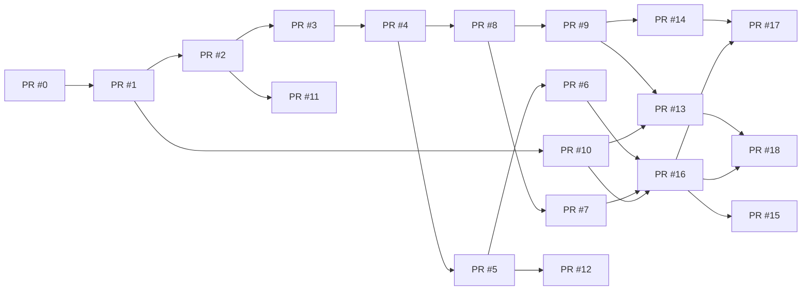

¶i# Rencana Pull Request — LGP v2.0 + Tim 10 Subagent

| Info          | Nilai                                                                                                         |
| ------------- | ------------------------------------------------------------------------------------------------------------- |
| Versi         | 1.0 — 2026-10-08                                                                                              |
| Cakupan       | PR #0–#15 (blueprint §13) diperluas + PR #16–#18 baru khusus tim 10 subagent                                  |
| Struktur repo | Monorepo `lgp/` sesuai blueprint §12.1                                                                        |
| Konvensi      | Branch per PR; setiap PR: deskripsi terformat (Masalah, Solusi, Uji, DoD), review wajib untuk merge ke `main` |

Milestone: **M0 Fondasi → M1 Runtime → M2 MCP & Memori → M3 Dashboard & Graph 3D → M4 Hardening**. Fase tim 10 subagent mengikuti Fase 0–7 pada makalah terkait.

---

## Bagian A — PR Fondasi & Runtime (Fase 0–1)

### PR #0 — `chore/monorepo-adr-ci`

- **Tugas**: skeleton monorepo (`apps/*`, `packages/*`, `infra/`, `migrations/`, `tests/`, `docs/`); ADR-001…010; CI (ruff, mypy, pytest, lint FE); pre-commit; `uv`/`pnpm` lock; template `.env`; Makefile (`make dev`).
- **Uji**: CI hijau pada PR kosong pertama; `make dev` menyalakan skeleton.
- **Depends**: —. **DoD**: ADR terbit di `docs/adr/`; pipeline CI aktif.

### PR #1 — `feat/infra-compose`

- **Tugas**: docker-compose (Supabase/Postgres 16, Redis 7 AOF, FalkorDB :6380, proxy, OTel Collector, Prometheus/Grafana/Loki); peta port §3.2; Alembic skema `langgraph` + `public` (Lampiran A); job backup (pgBackRest/WAL-G + snapshot FalkorDB); healthcheck semua service.
- **Uji**: `docker compose up` bersih tanpa bentrok port; asyncpg & checkpointer terkoneksi; backup job menghasilkan artefak.
- **Depends**: #0. **DoD**: compose idempoten dari keadaan bersih; skema terpasang via migrasi (bukan manual).

### PR #2 — `feat/runtime-core`

- **Tugas**: control plane FastAPI kompatibel LangGraph SDK (`assistants/threads/runs/store`); `AsyncPostgresSaver` + `AsyncPostgresStore` (koneksi langsung); durability mode `sync/async/exit`; `thread_registry`; auth JWT/API key; middleware konteks tenant.
- **Uji**: **uji kontrak** `langgraph_sdk.get_client()` membuat assistant/thread/run streaming; uji tenant A ≠ B.
- **Depends**: #1. **DoD**: uji kontrak SDK lulus 100%.

### PR #3 — `feat/queue-workers`

- **Tugas**: queue Redis Streams (lane `default/priority/batch`); lease + heartbeat; `XAUTOCLAIM` reaper; retry backoff + DLQ; event stream per-run (`run_events:{run_id}`) + SSE replay `Last-Event-ID`; reconciler; semaphore per workspace.
- **Uji**: **chaos test** bunuh worker saat run → lanjut dari checkpoint; klien SSE putus→nyambung menerima replay tanpa kehilangan event.
- **Depends**: #2. **DoD**: kedua uji chaos lulus di CI (Testcontainers).

---

## Bagian B — PR Eksekusi Aman & Registry Subagent (Fase 2)

### PR #4 — `feat/graph-registry-sandbox`

- **Tugas**: `graph_versions` immutable (sha256, status); pipeline propose→validate→promote→rollback; sandbox runner (Docker+gVisor, non-root, FS read-only, egress allowlist, secret `secret://` injection, limit CPU/RAM/PID/waktu); pin versi per run; canary/shadow.
- **Uji**: suite sandbox escape (kode berbahaya gagal egress ke luar allowlist, gagal baca secret platform, gagal fork-bomb); rollback < 10 dtk.
- **Depends**: #3. **DoD**: semua uji escape **gagal menembus**; rollback terukur.

### PR #5 — `feat/hitl-timetravel-policy`

- **Tugas**: interrupt/resume paralel (per interrupt-id); inbox HITL (konteks, SLA, penugasan); approval policy engine deklaratif; fork/time-travel dari checkpoint; diff state per node; aturan approver ≠ pengaju.
- **Uji**: alur approve/reject/edit; fork menghasilkan cabang baru dengan checkpoint; **AI tidak bisa approve dirinya sendiri** (uji negatif).
- **Depends**: #3. **DoD**: paritas API↔MCP untuk resume HITL.

### PR #8 — `feat/subagents-registry` *(naik ke Fase 2 sesuai makalah)*

- **Tugas**: tabel `subagent_registry` + kontrak (id, role, schemas, grants, model\_policy, budget, memory\_scope, trust\_level); **budget turun-temurun** (anak ≤ sisa induk) + enforcement runtime; deteksi loop (hash state); circuit breaker per subagent; format **context packet**; pola supervisor-via-tools + handoff swarm terbatas; effort scaling (1/2–4/≤10).
- **Uji**: properti budget (uji random: total anak tak pernah melebihi induk); loop terdeteksi → interrupt; dua stub (supervisor + 1 worker) bertukar context packet.
- **Depends**: #4. **DoD**: **Atlas v0** (supervisor + stub) jalan end-to-end; topologi terlihat via `lgp_subagent_topology`.

---

## Bagian C — PR Telemetri & Memori (Fase 3)

### PR #9 — `feat/telemetry-graph-correlation`

- **Tugas**: emitter event L1 (kontrak Lampiran C: node.start/end, delegate, tool.call, state.read/write, interrupt, error — dengan tokens & cost); Telemetry Graph (node/edge §7.1); kalkulator korelasi §6.3 (handoff\_rate, NPMI co-activation, success\_lift, latency\_coupling, state\_dependency, cost\_share, failure\_propagation); tabel `correlation_edges` + bobot per workspace (versi).
- **Uji**: uji properti korelasi (simetri ko-aktivasi, batas \[0,1\], deterministik pada input sama); `/api/graph/correlations` lulus kontrak.
- **Depends**: #8. **DoD**: matriks korelasi stub tersedia & deterministik.

### PR #10 — `feat/graphiti-memory`

- **Tugas**: `memory-service` (Graphiti sebagai library, `graphiti-core[falkordb]`); ontologi custom entity/edge (PascalCase / SCREAMING\_SNAKE\_CASE) + normalizer + `ontology_version`; ingest async (batch, dedup hash, anggaran harian, konkurensi terbatas); query bi-temporal (valid\_at/invalid\_at/created\_at/expired\_at); `group_id={tenant}:{workspace}`; redaksi PII.
- **Uji**: data sintetis — episode → node/edge dengan 4 timestamp; slider T\_v/T\_k memberikan hasil benar; dedup tidak menghasilkan duplikat.
- **Depends**: #1 (paralel dengan #9 setelah #3). **DoD**: ingest per-run berjalan async tanpa memblokir run.

---

## Bagian D — PR MCP (Fase 4)

### PR #6 — `feat/mcp-admin-server`

- **Tugas**: Admin MCP FastMCP (Streamable HTTP + stdio, stateless) di `/mcp/admin`; katalog `lgp_*` §5.3; scope token; **annotations eksplisit di semua tool**; dry-run; idempotency-key; approval-gated tools; rate limit; audit; `/mcp/agents` (agents-as-tools).
- **Uji**: **MCP Inspector/conformance**; alur penuh dari klien eksternal: propose→validate→promote(dev)→run→get\_state; uji `tools/list` semua tool punya annotations (CI gate).
- **Depends**: #5. **DoD**: klien eksternal (Claude Code/Desktop) menyelesaikan alur uji.

### PR #7 — `feat/mcp-outbound-hub`

- **Tugas**: outbound client manager (registry, health, cache `tools/list`); **grant per-node/subagent**; tool-call guard (validasi arg, timeout, batas output, redaksi secret, deteksi injection); (opsional) gateway MCP tunggal; kredensial per-tenant terenkripsi.
- **Uji**: subagent hanya melihat tool ter-grant; panggilan non-grant ditolak & tercatat; korpus injection → guard memblokir & melaporkan.
- **Depends**: #8. **DoD**: matriks grant subagent ↔ tools teruji otomatis.

---

## Bagian E — PR Evaluasi & Tata Kelola (Fase 5)

### PR #14 — `feat/evals-obs-usage`

- **Tugas**: dataset + eksperimen eval per assistant/subagent; regresi otomatis CI sebelum promote (gate); LLM-as-judge (judge ≠ model uji) + metrik deterministik; usage/cost dashboard; audit viewer; alert (queue lag, error rate, lonjakan biaya, ingest lag); SLO dashboard.
- **Uji**: promote dengan eval gagal ambang → **tertahan** (uji negatif); metrik usage cocok dengan `usage_ledger`.
- **Depends**: #9, #10. **DoD**: gate eval aktif di pipeline.

---

## Bagian F — PR Dashboard & Neuron Graph (Fase 6)

### PR #11 — `feat/dashboard-shell`

- **Tugas**: Next.js 15 + Shadcn; auth; layout; command palette; Overview; Assistants; Runs (SSE console); Threads; HITL Inbox; MCP Hub.
- **Uji**: E2E Playwright (login → run → live log tanpa stutter → resume HITL).
- **Depends**: #2 (bisa mulai dengan mock setelah #2; koneksi nyata setelah #6).

### PR #12 — `feat/dashboard-studio-timetravel`

- **Tugas**: Studio (DAG React Flow read-only + Monaco + diff + promote/rollback); Time-Travel workbench (pohon checkpoint, diff, mutasi, fork-run); halaman Subagents (registry, budget, circuit breaker, heatmap korelasi).
- **Uji**: **uji paritas** fork & promote dari UI == hasil via MCP (idempotent, state akhir sama).
- **Depends**: #11, #5, #8.

### PR #13 — `feat/neuron-graph-3d`

- **Tugas**: `NeuronGraph3D.tsx` (3d-force-graph, bloom terbatas, InstancedMesh); inspector drawer gaya MiroFish (identitas, bi-temporal, kontribusi korelasi + bar, sitasi episode, tetangga, aksi); dua slider waktu T\_v/T\_k + play; filter & layout; pulse live via WS; fallback 2D (sigma.js) >20k node; tabel aksesibel; `prefers-reduced-motion`.
- **Uji**: benchmark 60 fps @5k node/20k edge; isi drawer tertaut ke sumber (episode→run→step); audit a11y dasar.
- **Depends**: #9, #10, #11.

---

## Bagian G — PR Hardening & Tim Final (Fase 7)

### PR #15 — `feat/multitenant-rbac-hardening`

- **Tugas**: RBAC penuh (termasuk `AgentPrincipal`); RLS + uji isolasi lintas-tenant (API, MCP, SSE); kuota/metering + hard stop; secrets envelope encryption; SBOM + Trivy + pip/npm audit + pin digest; DR drill (restore terbukti); pen-test checklist.
- **Uji**: suite isolasi (tenant A tidak bisa baca thread/graf/graph tenant B via semua permukaan); uji restore bulanan pertama lulus.
- **Depends**: semua PR inti. **DoD**: checklist keamanan selesai.

### PR #16 — `feat/subagent-team-flagship` *(baru)*

- **Tugas**: seed `subagent_registry` dengan 10 kontrak final (Atlas, Clio, Vulcan, Athena, Hermes, Mnemosyne, Themis, Metron, Iris, Janus) sesuai makalah §5.3; graf per pod (supervisor-via-tools Atlas; handoff swarm Vulcan↔Athena); template context packet; konfigurasi budget default per workspace; uji isolasi grant kritis: Clio **tanpa** Admin MCP, Vulcan **tidak bisa** self-promote, Themis **tidak melihat** nilai secret.
- **Uji**: 10 subagent terdaftar & tervalidasi skema; uji negatif tiga aturan grant di atas; effort scaling enforcement (>4 subagent → konfirmasi).
- **Depends**: #6, #7, #8, #10. **DoD**: satu run lintas-pod lengkap (riset → rekayasa → review) dengan laporan biaya & topologi.

### PR #17 — `feat/subagent-evals-datasets` *(baru)*

- **Tugas**: dataset eval per subagent (10 × ≥20 kasus) + 3 skenario lintas-tim (riset, rekayasa, insiden); baseline biaya/latensi/kualitas; gating promote tim; deteksi drift biaya (±20%).
- **Uji**: CI menjalankan eval regresi pada setiap perubahan graf tim; baseline tersimpan & dibandingkan.
- **Depends**: #14, #16. **DoD**: gate aktif untuk tim 10 subagent.

### PR #18 — `feat/subagent-correlation-tuning` *(baru)*

- **Tugas**: UI pengaturan bobot α/β/γ per workspace (tersimpan, versi, hasil lama tak ditimpa); heatmap korelasi 10×10; prompt `design_subagent_team` memakai data telemetri nyata; playbook refactor tim ("gabung/pisah subagent"); peringatan `n < n_min`.
- **Uji**: perubahan bobot menghasilkan `weights_version` baru; perhitungan ulang inkremental konsisten dengan batch penuh.
- **Depends**: #12, #13, #16. **DoD**: saran refactor tim dihasilkan dari data ≥ 50 run nyata.

---

## Urutan Paralel yang Aman

- **Kritis jalur panjang**: #2→#3→#4 (jangan paralelkan).
- **Paralel setelah #3**: #9 &amp; #10.
- **#11** mulai dengan mock setelah #2.
- **#16** menyatukan semuanya; jadikan milestone "tim 10 subagent aktif".

## Ringkasan Estimasi

| Bagian           | PR      | Kompleksitas relatif | Catatan reviewer                              |
| ---------------- | ------- | -------------------- | --------------------------------------------- |
| Fondasi          | #0–#1   | Rendah               | Periksa peta port §3.2 terhadap `.env` nyata  |
| Runtime          | #2–#3   | Tinggi               | Uji kontrak SDK &amp; chaos adalah gate utama |
| Aman             | #4–#5   | **Sangat tinggi**    | Jangan merge tanpa uji escape sandbox lulus   |
| Subagent         | #8      | Tinggi               | Uji properti budget &amp; loop wajib          |
| MCP              | #6–#7   | Tinggi               | Conformance Inspector + annotations gate      |
| Memori/telemetri | #9–#10  | Sedang-tinggi        | Uji bi-temporal data sintetis                 |
| Dashboard        | #11–#13 | Sedang-tinggi        | Uji paritas UI↔MCP                            |
| Evaluasi         | #14     | Sedang               | Gate promote wajib aktif                      |
| Final            | #15–#18 | Sedang-tinggi        | #16 = integrasi besar tim subagent            |¶i2‰file:///home/biezz/Documents/Project/coding/langgraph/docs/Rencana%20Pull%20Request%20%E2%80%94%20LGP%20v2.0%20+%20Tim%2010%20Subagent.md