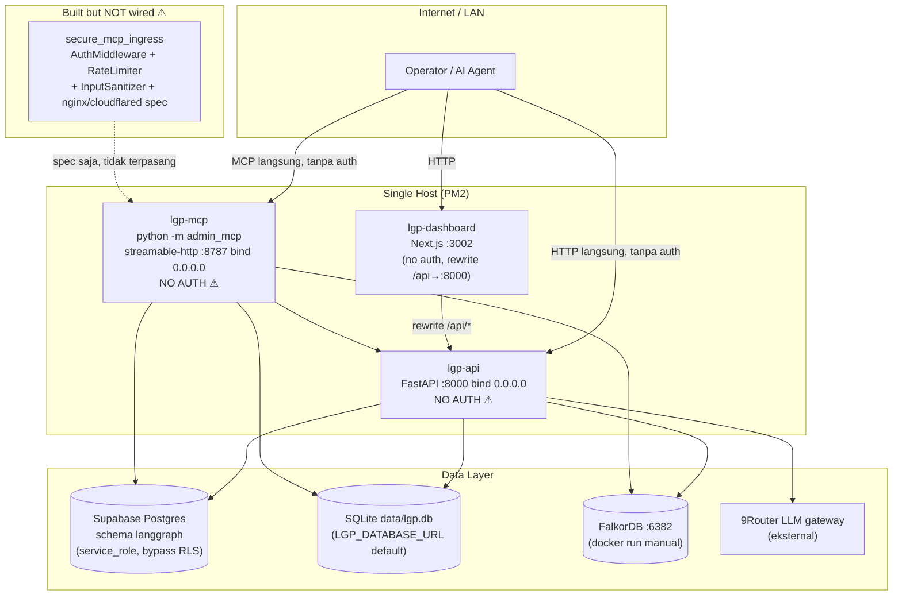
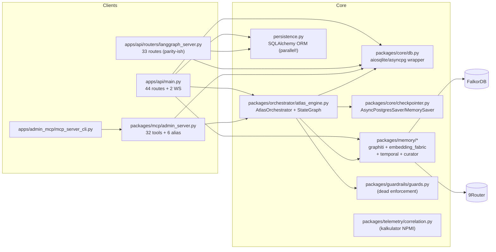

# Laporan Audit Menyeluruh — Enterprise LangGraph Platform (LGP v2.0)

**Tanggal:** 2026-11-14 · **Metode:** 30 subagent paralel + 1 agent sintesis (cross-check terhadap kode) · **Mode:** read-only
**Target evaluasi:** fondasi platform LangGraph enterprise self-hosted (dipakai pribadi dulu, siap multi-tenant, MCP penuh, subagent, dashboard + visualisasi graph)

---

## 1. Ringkasan Eksekutif

LGP v2.0 adalah project ambisius dengan **banyak komponen nyata yang mengesankan** — memory subsystem (Graphiti/FalkorDB + embedding fabric + bi-temporal facts), secure MCP ingress spec yang matang, audit hash-chain, dashboard visualisasi interaktif, dan graph StateGraph dengan idiom LangGraph 1.x yang benar di beberapa bagian. Namun audit menemukan bahwa **platform saat ini tidak berfungsi end-to-end pada jalur produksinya** dan memiliki **celah keamanan kritis yang sedang live**.

Temuan paling menentukan:

1. **Kredensial produksi live ter-commit** di `ecosystem.config.cjs` (Supabase service-role JWT + password DB) — wajib rotasi segera.
2. **Nol autentikasi** di dua port yang listen `0.0.0.0`: FastAPI `:8000` dan MCP admin `:8787`. Seluruh 32 admin tools dapat dipanggil anonim, termasuk `/mcp/admin/call`, `lgp_api_request` (SSRF proxy), dan mutasi memori/HITL/kanban. Stack `secure_mcp_ingress` yang sudah dibangun **tidak ter-wire sama sekali** ke deployment.
3. **Eksekutor inti mati end-to-end**: route shadowing membuat endpoint Atlas tidak terjangkau, task queue tidak punya worker, dan `lgp_run_resume_hitl` tidak pernah memanggil `resume_run` — HITL approval hanya mengubah flag DB.
4. **"10 subagent" adalah stub hardcode** — tidak ada LLM call, tools, atau prompt nyata di native path; jalur DeepAgents (satu-satunya yang "nyata") tidak dapat diakses karena model tidak pernah dikonfigurasi.
5. **Tiga skema database saling bertentangan** untuk tabel yang sama (`threads`/`runs`/`checkpoints`) → error "no such column" tersebar; plus tabrakan nama tabel `checkpoints` dengan AsyncPostgresSaver.
6. **Multi-tenancy tidak ada sama sekali**: nol kolom tenant, RLS `USING(true)` untuk anon di semua tabel (termasuk `audit_log` & `temporal_facts`), koneksi sebagai superuser.

### Skor per dimensi

| Dimensi | Skor | Justifikasi singkat |
|---|---|---|
| Keamanan | **2/10** | Live creds di git + nol auth di 2 port + admin tools terbuka + Cypher injection + RLS permisif. Stack ingress bagus tapi tidak dipakai. |
| Kualitas kode | **3/10** | Dual/triple schema, dead code masif (guardrails, SSE publish, resume, worker), bug deterministik (`asyncio` NameError, `logger` NameError, `datetime+coroutine`), route duplikat, bare except. Positif: struktur paket rapi, test security ingress bagus. |
| Kapabilitas | **3/10** | Memory/embedding fabric/telemetry/dashboard nyata & kuat; tapi subagent stub, tidak ada document RAG, observability tanpa tracing standar, semua aksi tulis dashboard ilusi. |
| Kesesuaian LangGraph | **4/10** | Positif: StateGraph + reducers + `interrupt()`/`Command(resume)` + AsyncPostgresSaver resmi. Negatif: tanpa `astream`, tanpa Store API, tanpa Send/subgraph, SSE non-standar, tak kompatibel `langgraph-sdk` tanpa adapter besar. |
| Kesiapan enterprise | **2/10** | Nol auth, nol multi-tenancy, nol CI, nol backup/DR, nol worker, path hardcode `/home/biezz`, secrets di git, audit bisa dipalsukan. Hanya dokumentasi & spec deployment yang patut nilai. |

**Verdict:** Fondasi *konseptual* menarik dan sebagian kode berkualitas, tetapi **belum layak sebagai fondasi enterprise** tanpa program perbaikan terfokus. Estimasi kasar ke "enterprise self-hosted fungsional": ~3–6 bulan untuk 1 engineer pada scope penuh (auth, skema, eksekusi, multi-tenancy); quick wins bisa mengamankan deployment dalam 1–2 hari.

---

## 2. Gambaran Arsitektur & Peta Komponen

### Arsitektur aktual (deployment live)

### Arsitektur internal (kode)

**Masalah struktural utama:** 3 lapisan persistence paralel (`db.py` raw SQL, `persistence.py` ORM, `checkpointer.py` psycopg pool) dengan skema tabel yang saling bertentangan; 2 engine eksekusi paralel (StateGraph stub vs DeepAgents); 2 permukaan API yang route-nya saling men-shadow.

---

## 3. Laporan Keamanan

### 3.1 Temuan Critical

| ID | Temuan | Bukti | Status | Rekomendasi |
|---|---|---|---|---|
| SEC-01 | **Kredensial produksi live ter-commit**: `SUPABASE_SERVICE_ROLE_KEY` (JWT service_role, exp ~2041) + `SUPABASE_DB_PASSWORD` plaintext di PM2 env, ter-track git sejak commit `38ba03a` | `ecosystem.config.cjs:19,24,45,50` | Terverifikasi (parent: `git ls-files` + git log) | Rotasi service-role key & DB password di Supabase **sekarang**; pindah ke `.env`/`env_file`; `git rm --cached` + rewrite history (git-filter-repo); anggap kredensial compromised permanen |
| SEC-02 | **FastAPI :8000 tanpa autentikasi/otorisasi/rate-limit/sanitizer** — semua endpoint mutasi terbuka: `/mcp/admin/call` (GET+POST), `/api/hitl/resolve`, `/api/runs`, `/api/memory/*`, `/api/kanban/*`, `/api/store/items` DELETE, `/api/events/broadcast`, WS | `apps/api/main.py:62-68` (hanya CORS); `:645-655`,`:292-305`,`:662-665` | Terverifikasi (live: `curl :8000/api/health` → 200 tanpa auth; listen `0.0.0.0`) | Middleware/API-key/JWT global; default-deny untuk mutasi; actor dari principal terverifikasi, bukan argumen |
| SEC-03 | **MCP admin server :8787 tanpa auth**, bind `0.0.0.0`, `mcp.run` tanpa `token_verifier`/middleware — `secure_mcp_ingress` tidak dipakai deployment manapun (hanya tests) | `ecosystem.config.cjs:30`; `apps/admin_mcp/mcp_server_cli.py:428-431`; `packages/mcp/auth.py` tidak ada | Terverifikasi (live listener `0.0.0.0:8787`) | Ganti entrypoint PM2 ke `hardened_server_app.py` atau implement `token_verifier` MCP SDK; bind `127.0.0.1` + tunnel sesuai spec SA1 |
| BUG-05* | **Route shadowing**: `include_router(langgraph_server_router)` di `main.py:78` sebelum route kustom → `POST /api/runs`, `GET /api/runs/{id}`, `/stream`, `/api/health` milik orchestrator Atlas **tidak terjangkau** | `apps/api/main.py:78` vs `:89,130,169,179,191`; router `:761,939,1137,1374` | Terverifikasi (synthesis naik ke Critical) | Prefix versioning (`/api/v1` vs `/api/langgraph`) atau reorder; hapus duplikat |

### 3.2 Temuan High

| ID | Temuan | Bukti | Skenario eksploitasi | Perbaikan |
|---|---|---|---|---|
| SEC-04 | `tokens_store.json` ter-commit: 5 record, 3 ACTIVE, hash SHA-256 + metadata scopes/audience bocor | `secure_mcp_ingress/auth/tokens_store.json` | Recon metadata; verifikasi offline hash lemah | gitignore + HMAC pepper + pindah ke DB |
| SEC-05 | Firewall script hanya cover 8787/8088; port 8000 & 3002 tanpa rule; kedua port listen `0.0.0.0` | `secure_mcp_ingress/config/setup_firewall.sh:18-19`; `ecosystem.config.cjs:6,30,56` | API/dashboard terekspos LAN/Internet tanpa TLS/auth | Bind `127.0.0.1` atau tambah rule; verifikasi `ss -tlpn` di host |
| SEC-06 | **Cypher injection** di `rehydrate_falkordb_from_db`: f-string Cypher; `episode_run_id`/`rid`/`fid`/`valid_at` tanpa escape; obj/subj/pred hanya `.replace("'","\\'")` | `packages/memory/graphiti.py:1914-1979`; dipicu `POST /api/graph/rehydrate` (tanpa auth) | Simpan fact `object="x') ... //"` via `lgp_memory_store_fact` → rehydrate → Cypher arbitrer di FalkorDB (baca/tulis/hapus graf) | Parameterized query FalkorDB (`$param`) atau escape `''` doubling + whitelist ID |
| SEC-07 | **`lgp_api_request` = SSRF/proxy admin tak terbatas**: `http://localhost:8000{endpoint}` method/body arbitrer, bisa rekursi `/mcp/admin/call` | `packages/mcp/admin_server.py:941-983` | `POST /mcp/admin/call {tool:lgp_api_request, endpoint:/api/hitl/resolve}` → bypass HITL, mutasi apa pun | Allowlist method+path, blokir `/mcp/admin/call`, batasi kedalaman, auth di target |
| SEC-08=BUG-04 | **HITL resume putus + spoofable**: `lgp_run_resume_hitl` hanya UPDATE `hitl_inbox`; approver self-asserted; tidak memanggil `resume_run`/`Command(resume)` | `admin_server.py:678-704`; `atlas_engine.py:791-800` (hanya dipanggil tests) | Approve run sendiri / audit palsu; run stuck `interrupted` selamanya | Resolve interrupt_id→thread_id→`orchestrator.resume_run`; actor dari principal; idempotency `WHERE status='pending'` |
| SEC-09 | Auth middleware flaws (bila dipakai): `verify_token` tanpa `requested_aud` (RFC 8707 bypass); JSON-RPC batch bypass scope check; XFF spoofing rate limiter (entry pertama, tanpa trusted-proxy); rate limit jalan sebelum auth | `auth_middleware.py:139,170-174`; `rate_limiter.py:184-188`; `hardened_server_app.py:127-130` | Token audience lain diterima; batch `tools/call` bypass scope `memory:*`; rotasi XFF reset kuota | Forward `requested_aud`; iterasi batch; XFF hanya dari trusted proxy / key by token_hash; auth sebelum rate-limit |
| SEC-14 | **Nol multi-tenancy**: 0 kolom `tenant_id`/`org_id`/`user_id` di semua tabel; RLS `USING(true)` untuk anon + `GRANT SELECT TO anon` di semua tabel termasuk `audit_log`/`temporal_facts`; app connect sebagai postgres/service_role (bypass RLS); IDOR di semua endpoint; event bus broadcast tanpa filter; graphiti `group_id` opsional spoofable | `supabase-schema.sql:281-312`; `schema.sql`; `persistence.py`; `db.py:221-251`; `langgraph_server.py` semua lookup by-ID; `graphiti.py:1047,1440` | Siapa pun dengan anon key membaca seluruh memori/audit; siapapun dengan thread_id/reserve store namespace orang lain | Lihat §7 gap analysis — butuh redesign tenant-aware |
| SEC-20+21 | `mcp>=1.0.0` tanpa lock → CVE-2026-52869 (session principal bypass), GHSA-fmmv-w9g8-j3gc (body DoS), CVE-2026-59951, CVE-2026-116686; **tidak ada lock file Python**, semua deps `>=`; deps runtime tak terdeklarasi (`python-dotenv`, `numpy`, `graphiti-core[falkordb]`, `falkordb`, `openai`, `sqlalchemy`, `langgraph-sdk`, `pytest`, `pytest-asyncio`) | `pyproject.toml:7-27` | Supply chain tidak reproducible; CVE pada transport streamable-http yang dipakai | `uv.lock`/`pip-compile --generate-hashes`; pin exact; `mcp>=1.30.0`; deklarasikan semua deps + dev-deps; `pip-audit` di CI |
| BUG-06 | **Task queue tanpa worker**: run via router hanya enqueue `task_type="run"`; `/tasks/dequeue` ada tapi nol consumer; `cancel_run` cancel `run_id` padahal task PK `task_id` | `langgraph_server.py:828-839,1332-1367,1037-1038` | Run `pending` selamanya; wait 408; cancel tidak membatalkan task | Implement worker dequeue→execute→complete, atau hapus enqueue path; cancel by task_id |
| BUG-07=LG-04 | **SSE streaming mati total**: `SSEStreamManager` per-request, `publish()` tidak pernah dipanggil; `stream_mode` diabaikan; replay baca tabel checkpoints yang tak pernah ditulis; tidak ada `metadata`/`end`; format non-standar LangGraph; `run_event_queues` diisi setelah run selesai + unbounded + `rejected` bukan status terminal | `langgraph_server.py:376-451,928,1137-1157`; `main.py:86,150-160,191-233` | Stream hang kosong; client SDK tidak kompatibel | Singleton manager/registry per run_id; publish dari `_emit_event`; stream_mode validation; heartbeat + sentinel end; bounded queue + cleanup |
| BUG-08 | **`execute_run` tanpa error handling**: exception di node/DB → `runs.status` stuck `'running'`; `state["error"]` dead field; tidak ada transisi `failed`; tidak ada reaper stale runs | `atlas_engine.py:567-743` (no try/except sekitar `graph.ainvoke:742`); `:59` | Crash → run zombie; audit/status bohong | try/except/finally → `status='failed'` + audit + event; startup reaper |
| BUG-11 | **Guardrails mati total**: `validate_subagent_tool_access` return dibuang; `sanitize_input` nol call-site; `tool_grants` tak ditegakkan; `CircuitBreaker.record_failure/success` tak pernah dipanggil; `validate_delegation_budget` tak dipanggil; budget/token hardcoded | `atlas_engine.py:264,249-250,284-285,672-673`; `guards.py:12-74`; `contracts.py` | Proteksi budget/tool/sanitize/circuit = ilusi; run tanpa batas biaya | Wire enforcement nyata atau hapus agar tidak menyesatkan; persist breaker ke DB |
| BUG-12=CAP-01 | **10 subagent = stub hardcode**: `make_subagent_node` output literal per agent, tanpa LLM/tools/prompt; DeepAgents path bypass checkpointer/HITL/budget/telemetry, model None dari API → jalur mati | `atlas_engine.py:205-370,623-712,100`; `main.py:80`; `contracts.py:244-302` | Klaim "10 subagent multi-agent" tidak terpenuhi; hasil run palsu | Implement runtime subagent nyata (compiled subgraph/LLM node + tools per `tool_grants`) atau tandai eksplisit mock |
| BUG-13 | Asyncio/singleton races: `_active_callback` shared mutable; `self.checkpointer` mutable; `thread_id` tidak unik per run → checkpoint collision + `operator.add` akumulasi lintas run; lazy-init pool/driver tanpa lock; `_setup_completed` global lintas schema | `atlas_engine.py:84,578,715-718,741,50-60`; `checkpointer.py:124-138` | Concurrent runs → event salah route, state tercampur, cost/token menggelembung | contextvars/config per-run; checkpointer immutable; unique thread key; lock init |

### 3.3 Temuan Medium

| ID | Temuan | Bukti | Perbaikan |
|---|---|---|---|
| SEC-10 | Token verify hanya baca `tokens_store.json`; sync Supabase best-effort `except:pass`; revokasi remote tak efektif; race read-modify-write | `token_manager.py:84-148,213-215` | Satu source of truth (DB); log sync errors; file lock/cache |
| SEC-11 | Input sanitizer bypass: scan-sebelum-normalize (NFKC setelah scan → full-width lolos), zero-width tak distrip, hanya POST/PUT/PATCH, tanpa max body, GET tak discan; hanya cover :8787 | `input_sanitizer.py:141-147,231-246` | Normalize dulu baru scan; strip zero-width; max body size; perluas coverage ke :8000 |
| SEC-12 | MCP tool input tanpa validasi server-side (schema JSON deklaratif saja); `limit` unbounded; `trust_level`/`max_usd` tanpa range; LIKE wildcard | `admin_server.py:546,585-612,661,713-725` | Pydantic per-tool; clamp limit; enum+range validation; escape LIKE |
| SEC-13=BUG-15 | Audit log integrity: `result_status="success"` dicatat SEBELUM eksekusi; actor self-asserted; hash chain race fork; `log_id` collision | `admin_server.py:547`; `db.py:543-565` | Audit pasca-eksekusi dengan status riil; actor dari principal; transaksi/lock chain; UUID log_id |
| SEC-15 | Indirect prompt injection via memori: fakta tanpa sanitasi → `to_agents_markdown` hanya escape `\|` → inject `/memory/AGENTS.md` DeepAgents | `temporal.py:95-109`; `atlas_engine.py:635-645` | Sanitasi konten fakta; delimiter tegas data vs instruksi; aktifkan `SecurityToolGuard.sanitize_input` |
| SEC-16 | PII redaction parsial: hanya `object`, bukan `subject`/`predicate`; fallback episode simpan body mentah `pii_redacted=0` | `temporal.py:49-53`; `graphiti.py:1086-1087` | Redact ketiganya; redact sebelum insert fallback |
| BUG-10 | Loop detector dead-end + false positive cross-run: hash tanpa `run_id`; interrupt hanya flag state (bukan `interrupt()`) → `resume_run` ValueError; hitl_id non-deterministik | `guards.py:55-74`; `atlas_engine.py:226-246,797` | Scope detector per run; pakai `interrupt()` native atau restart eksplisit |
| BUG-14 | Memory bugs: fallback `add_episode` fact_id deterministik-ms + ISO string ke kolom REAL + PII mentah; unbounded `MATCH(n)`/`SELECT *`; `embedding_space_id` dari dimensi diminta bukan aktual; `zip` silent-drop + unordered; `create_batch` slice MRL naive; `create()` abaikan list; `_to_float` timezone bug + crash non-ISO; `expired_at` +365d silent expiry | `graphiti.py:1083-1089,1440,1532,834-855,857-869`; `embedding_fabric.py:426-435,449-468`; `temporal.py:16-20,57` | uuid fact_id; epoch float; LIMIT/pagination; space_id dari `len(vector)` aktual; assert len+sort by index; fix `_to_float`; expired_at configurable |
| BUG-16 | `hermes_sync` query kolom tidak ada (`id/fact_text/...` vs `fact_id/subject/...`) → selalu gagal silent; blocking file I/O di async; non-atomic JSON write; ID collision | `hermes_sync.py:310-343,108-114,285-305` | Map ke skema benar atau hapus; `asyncio.to_thread`; temp+rename; uuid IDs |
| BUG-17 | `/api/embedding/atlas` selalu 500: select kolom `id` (harus `fact_id`) + `logger` undefined (NameError) + connection leak | `main.py:887-921` | Fix kolom, definisikan logger, try/finally close |
| BUG-18 | Route duplikat `GET /threads/{id}/runs` (960 vs 1160); `Assistant.metadata_json` attr tak ada (506); store endpoints Postgres-only (`pg_insert`,`.astext`,`@>`) di SQLite default; store delete tanpa namespace = hapus semua; namespace JSON-string vs dot-joined mismatch | `langgraph_server.py:960,1160,506,1202-1325` | Hapus duplikat; fix attr; portable JSON query; wajibkan namespace |
| BUG-19* | `POST /api/runs` synchronous blocking + no idempotency + `requested_subagents` tak divalidasi — *catatan: saat ini unreachable karena BUG-05* | `main.py:150`; `atlas_engine.py:123-140` | BackgroundTasks/queue; idempotency key; validasi ke CONTRACTS_MAP |
| BUG-20 | Error handling: bare except (`db.py:206`, token sync, hermes); `HTTPException(detail=str(e))` bocorkan internal | `main.py:858-860,919-921,939-941,947-950` | Pesan generik + correlation ID; log detail server-side |
| BUG-21 | embedding_fabric: rate limiter sleep-lalu-call; `embed_race` fallback duplikasi; `project_embeddings_2d` PCA bukan UMAP (label UI menyesatkan); `ensure_vector_indexes` satu dim; `np.array` crash dimensi campur | `embedding_fabric.py:373-376,485-535,701,746-786` | Loop acquire/backoff; validasi dimensi; perbaiki label/kalkulasi dim |
| SEC-17 | Path traversal `board_id` di filename hermes sync | `hermes_sync.py:286` | Whitelist `^[a-zA-Z0-9_-]+$` atau `basename`+resolve check |
| SEC-18 | Migration script schema name f-string SQL (CLI lokal, low risk) | `migrate_sqlite_to_supabase.py:255,271` | Quote identifier / whitelist |

### 3.4 Ringkasan severity

| Severity | Jumlah (kanonik) |
|---|---|
| Critical | 5 (SEC-01, SEC-02, SEC-03, SEC-06→High, BUG-05, BUG-04, BUG-02, BUG-03 — lihat catatan*) |
| High | ±15 |
| Medium | ±15 |
| Low/Info | ±8 |

\* Severity final pasca-sintesis: **Critical** = SEC-01 (secrets live), SEC-02 (no-auth API), SEC-03 (no-auth MCP), BUG-05 (executor unreachable), BUG-04 (HITL mati), BUG-02 (dual schema), BUG-03 (tabrakan checkpoints), SEC-14 (nol multi-tenancy untuk konteks enterprise). **High** = SEC-04–SEC-13 sebagian, SEC-06, SEC-07, BUG-06–BUG-14.

**Catatan positif keamanan:** token disimpan SHA-256 hash (bukan plaintext), file `0600`, atomic write; token generation CSPRNG; `WWW-Authenticate` challenge benar; SQL produksi semuanya parameterized; tidak ada command injection/XSS; `.env` tidak pernah ter-commit; spec ingress (SA1/SA2) dan test security `test_e2e_security.py` berkualitas.

---

## 4. Laporan Bug

### 4.1 Bug Critical/High (ringkas — detail di §3 untuk yang beririsan keamanan)

| ID | Lokasi | Dampak | Reproduksi | Perbaikan |
|---|---|---|---|---|
| BUG-01 | `packages/core/db.py:1-11,196-211` | `import asyncio` hilang → `NameError` tertelan `except` → **Supabase pool di-terminate & dibuat ulang SETIAP `get_db_connection`** (pool churn total saat USE_SUPABASE=true) | USE_SUPABASE=true + kredensial valid; 2× `get_db_connection` → 2 pool | `import asyncio`; simpan loop-id |
| BUG-02 | `db.py:344-376` vs `persistence.py:145-214` vs `supabase-schema.sql` | **Tiga skema tabel `threads/runs/checkpoints` tidak kompatibel**; `persistence.init_db()` tidak pernah dipanggil; `create_langgraph_tables` hanya buat 3 tabel → semua endpoint ORM `/api/threads*`, `/api/runs*` (router) → "no such column" 500 | Start app SQLite → `POST /api/threads` → 500 | Satu schema canon + migrasi nyata (Alembic) atau rewrite router ke skema core |
| BUG-03 | `supabase-schema.sql:65-73` vs AsyncPostgresSaver MIGRATIONS | Tabel `langgraph.checkpoints` skema app bertabrakan dengan tabel saver (`thread_id/checkpoint_ns/...`); `CREATE TABLE IF NOT EXISTS` → salah satu konsumen pasti rusak | Apply schema.sql lalu saver.setup() (atau sebaliknya) | Rename tabel app → `app_checkpoints` di semua layer |
| BUG-04 | `admin_server.py:678-704` | HITL resume tidak memanggil `resume_run` → approve = palsu, run stuck `interrupted` | Run vulcan/themis → approve via API → status tetap interrupted | Sambungkan ke `orchestrator.resume_run` (lihat SEC-08) |
| BUG-05 | `main.py:78` | Route shadowing → executor Atlas unreachable via HTTP | `POST /api/runs {"objective":"x"}` → 422 (butuh assistant_id) | Prefix/reorder (lihat SEC-*) |
| BUG-06 | `langgraph_server.py:828-839,1332` | Task queue tanpa worker → run pending selamanya | Create run via router → wait → 408 | Worker atau hapus path |
| BUG-07 | `langgraph_server.py:376-451,928,1149`; `main.py:86,150-160` | SSE tidak pernah publish; manager per-request; queue leak; `rejected` bukan terminal | `GET /api/runs/{id}/stream` → hang kosong | Singleton + publish + cleanup + status enum |
| BUG-08 | `atlas_engine.py:567-743` | Exception → run zombie `running`; tidak ada `failed` transition/reaper | Paksa exception di node → cek `runs.status` | try/except/finally + reaper |
| BUG-09 | `langgraph_server.py:838` | `datetime.now() + asyncio.sleep(...)` → TypeError saat `after_seconds` diisi | `POST /api/runs {"after_seconds":5}` → 500 | `timedelta(seconds=...)` |
| BUG-10 | `guards.py:55-74`; `atlas_engine.py:226-246` | Loop detector false-positive cross-run + interrupt non-resumable | 3× run objective sama → run ke-3 interrupted; resume → ValueError | Scope per run; `interrupt()` native |
| BUG-11 | `atlas_engine.py:264,249-250`; `guards.py` | Guardrails/budget/circuit breaker dead code | Audit call graph → tidak ada enforcement | Wire atau hapus |
| BUG-12 | `atlas_engine.py:205-370,623-712` | Subagent stub hardcode; DeepAgents bypass semua guard | Run apa pun → `delegates_report` canned | Runtime nyata atau tandai mock |
| BUG-13 | `atlas_engine.py:84,578,715-718,741`; `checkpointer.py:124-138` | Race: callback/checkpointer shared; thread_id collision; lazy-init tanpa lock | 2× `execute_run` paralel → event salah route | contextvars; immutable per-run; unique thread |
| BUG-14 | `graphiti.py`, `embedding_fabric.py`, `temporal.py` | ~12 bug memory (lihat SEC-16 & §3.3) | Beragam (lihat §3.3) | Lihat rekomendasi per item |
| BUG-15 | `db.py:543-565`; `db.py:163-184` | Audit hash-chain race fork; `log_id` collision; Postgres `commit()` no-op → multi-write non-atomik | Concurrent `record_audit_log` | Transaksi/lock; UUID; transaction context |
| BUG-16 | `hermes_sync.py:310-343` | Memory sync query kolom salah → selalu gagal silent ("success") | Jalankan sync → 0 facts tersimpan | Map skema benar / hapus fitur |
| BUG-17 | `main.py:887-921` | `/api/embedding/atlas` selalu 500 + connection leak | `GET /api/embedding/atlas` | Fix kolom/logger/finally |
| BUG-18 | `langgraph_server.py:960,1160,506,1202-1325` | Route duplikat; attr salah; store Postgres-only di SQLite; namespace mismatch | Beragam | Lihat §3.3 |
| BUG-20 | `main.py:858-950` | Exception detail bocor ke client | Provider error → 500 dengan internal detail | Generic message + correlation ID |
| BUG-21 | `embedding_fabric.py` | Rate limiter tak efektif; dimensi index salah; PCA-vs-UMAP label | Beragam | Lihat §3.3 |
| BUG-22 | `hermes_sync.py`, `admin_server.py`, `atlas_engine.py` | ID collision ms-timestamp; dedup race; `init_db` race; korelasi split-brain; synthesizer edges degenerate; `get_temporal_facts` abaikan bi-temporal + `similarity:1.0` fabricated; `/api/hitl` query kolom tak ada | Beragam | UUID/ULID; constraint+transaksi; satu config store; filter bi-temporal; map kolom benar |

### 4.2 Kualitas test & repo hygiene

- **Coverage:** 9 file pytest di `tests/` + 5 di `secure_mcp_ingress/tests/` (di luar `testpaths`) + 5 script root yang tidak di-collect. Coverage baik untuk contracts/guardrails/orchestrator/HITL/embedding/graphiti/MCP admin/security ingress; **tanpa test**: `curator.py`, `db_supabase.py`, `event_bus.py`, `hermes_sync.py`, `langgraph_server.py` (SSE/queue), dashboard.
- **Masalah:** test butuh infra live (FalkorDB:6382, Supabase, 9Router, Docker nginx) tanpa marker/skip → gagal di CI; test menulis ke `data/lgp.db`/Supabase produksi tanpa isolasi; `test_sa1_ingress.py` hardcode path `/home/biezz`; root `test_*.py` print-only tanpa assert.
- **Hygiene:** `_probe*.py`, `test_server.py` (launcher), `*.log`, `.state/` tidak di-gitignore; `pyproject.toml` tanpa `[build-system]`/dev-deps; `src/lgp` tanpa `__init__.py`; `pip install -e .` kemungkinan gagal; path absolut `/home/biezz` di PM2/scripts/hermes.

---

## 5. Inventaris Kapabilitas

| Domain | Status | Bukti kunci |
|---|---|---|
| **Subagent (10)** | ❌ Stub | Kontrak ADA (`contracts.py`), runtime hardcode (`atlas_engine.py:205-370`); DeepAgents path mati (`main.py:80` model=None) |
| **MCP tools** | ⚠️ Parsial | 32 tools + 6 alias implementasi nyata (`admin_server.py`, `mcp_server_cli.py`); tanpa resources/prompts; annotations tak diteruskan; gap: graph CRUD, dedicated thread/run/store tools, MCP client internal |
| **Memory/Graphiti** | ⚠️ Parsial | Ingestion episode ADA; **search tidak pernah dipanggil**; cross-encoder no-op; community detection tidak ada |
| **Embedding fabric** | ✅ Kuat | 10 model/5 provider via 9Router; race/shard/ensemble + RRF; rate-limit+breaker (parsial efektif); tanpa caching/vector-store write |
| **Bi-temporal facts** | ✅ ADA | `valid_at/invalid_at` + `created_at/expired_at`; point-in-time query; PII redaction parsial |
| **Memory curation** | ⚠️ Parsial | Dedup exact-match saat seed saja; tanpa decay/consolidation/promotion otomatis; Mnemosyne stub |
| **Document RAG** | ❌ Tidak ada | Tidak ada ingestion/chunking dokumen |
| **Retrieval saat run** | ❌ Native path | Hanya DeepAgents dump SEMUA fakta ke AGENTS.md tanpa top-k/rerank/budget |
| **Observability** | ⚠️ Parsial | `telemetry_events` + audit hash-chain ADA; token/cost hardcoded; tanpa tracing standar/metrics/alerting/request-id |
| **Audit trail** | ⚠️ Parsial | Hash-chain SHA-256 ADA; `result_status` selalu success; actor palsu; tanpa audit auth events |
| **HITL** | ⚠️ Graph-native / ❌ end-to-end | `interrupt()`+`Command(resume)` benar; resume produksi putus; UI tidak POST |
| **Streaming** | ❌ | Tidak ada `astream`; SSE custom non-standar, publish tak pernah dipanggil |
| **Dashboard** | ⚠️ UI nyata / ❌ aksi tulis | 10 halaman + visualisasi interaktif real; semua aksi tulis ilusi (state lokal); shape mismatch; zero auth |
| **Deployment** | ⚠️ Spec lengkap / ❌ wired | PM2 3 proses; ingress spec matang tapi middleware tak ter-wire; cloudflared UUID placeholder; tanpa backup/worker/CI |
| **LangGraph API parity** | ❌ | Router parsial legacy; SDK thread-scoped routes hilang; status vocabulary salah; store/cron/state incompatible |
| **Multi-tenancy/RBAC** | ❌ | Nol tenant columns; RLS `USING(true)` anon; superuser connection; IDOR menyeluruh |

---

## 6. Analisis Kesesuaian LangGraph

### 6.1 Yang sudah sesuai (pertahankan)

- **StateGraph + TypedDict + reducers `operator.add`** — `AtlasState` (`atlas_engine.py:43-60`) benar untuk merge semantics.
- **Node signature async `(state)->dict` partial-update** — semua node patuh.
- **`interrupt()` + `Command(resume=payload)`** di approval node (`:405`,`:799`) — idiom LangGraph 1.x yang tepat, dengan idempotent pre-interrupt (`ON CONFLICT DO NOTHING`, event_id deterministik).
- **Time-travel native** — `aget_state_history`/`aupdate_state` (`:802-830`), ditest di `test_hitl_time_travel.py`.
- **AsyncPostgresSaver resmi** via `langgraph-checkpoint-postgres` + psycopg3 pool (`checkpointer.py`) — bukan custom saver.
- **Versi kompatibel**: `langgraph~=1.2` ↔ `checkpoint-postgres~=3.1` ↔ `deepagents>=0.7.25` (via langchain).
- **`create_deep_agent` + `StateBackend` + `SubAgent` conversion** dipakai benar secara API (`:109-116`, `contracts.py:244-302`).

### 6.2 Yang menyimpang / harus di-refactor

| Area | Deviasi | Dampak |
|---|---|---|
| Eksekusi subagent | Node = closure stub, bukan LLM/subgraph; sequential via `route_next` (tanpa `Send`) | Fitur inti tidak nyata; tidak parallel |
| Checkpoint | Fallback `MemorySaver` saat non-Supabase (state hilang restart); tabrakan tabel `checkpoints`; DeepAgents path tanpa checkpointer | Persistensi tidak reliable; schema conflict |
| Store/long-term memory | Tidak ada `BaseStore`; `store_items` REST custom tidak kompatibel; memory via service-locator `get_db_connection` | Tidak kompatibel LangGraph Platform; no namespace isolation |
| Streaming | Tidak ada `astream`/`astream_events`; SSE format custom (event types salah, no `metadata`/`end`/`stream_mode`/token messages) | `langgraph-sdk` tidak kompatibel |
| HITL service layer | Custom `hitl_inbox` + MCP tool menggantikan resume native; tidak terhubung ke `resume_run` | HITL mati end-to-end |
| API surface | Router `/api` legacy-style parsial; SDK thread-scoped routes hilang; status vocab salah (`completed` vs `success`) | Parity kosmetik; SDK unusable |
| Multi-agent pattern | Single flat graph; tidak ada subgraph/`Send`/`Command(goto)`/handoff tools | Bukan multi-agent sesungguhnya |
| Observability | `telemetry_events` custom, bukan trace spans; `trace_id` dead code; tanpa LangSmith/OTel | Tidak ada distributed tracing |
| Deployment artifact | Tidak ada `langgraph.json`, graph bukan module-level compiled, tidak ada Dockerfile app | Studio/`langgraph dev`/`langgraph build` tidak bisa |

### 6.3 Peta migrasi ke LangGraph enterprise self-hosted

**Opsi A — Adopt LangGraph Platform resmi (Strategi A di ADR-011):**
- Keuntungan: threads/runs/assistants/store/cron/SSE/auth/API parity gratis; Studio & SDK langsung jalan.
- Syarat: `langgraph.json` + module-level `graph`; lisensi Elastic License 2.0 (self-hosted OK) + LangSmith Enterprise untuk tracing penuh (atau self-host alternatif).
- Effort: ~2–4 minggu integrasi + penyesuaian memory/checkpoint.

**Opsi B — Pertahankan custom FastAPI (Strategi B, status quo):**
- Perbaiki router agar benar-benar mengeksekusi graph (worker task queue → `AtlasOrchestrator`), satukan skema, implementasikan SSE official-compatible, tambah thread-scoped routes.
- Effort parity SDK: ~4–8 minggu (adapter + execution backend) sesuai estimasi LG-08; parity penuh (cron, versions, A2A): ~3–6 bulan.

**Rekomendasi:** Pertahankan Strategi B untuk fase awal (kontrol penuh, tanpa dependency lisensi), tapi **ekstrak graph ke `graph.py` module-level + `langgraph.json` minimal** agar `langgraph dev`/Studio bisa dipakai gratis untuk development/debug. Evaluasi ulang Strategi A setelah auth+skema beres.

---

## 7. Gap Analysis menuju LangGraph Enterprise Self-Hosted

| Capability target | Gap | Severity gap |
|---|---|---|
| AuthN/Z semua permukaan | Nol auth di :8000 & :8787; ingress spec tidak ter-wire | Blocker |
| Multi-tenancy (RLS/RBAC) | Nol tenant schema; RLS permisif; superuser connection; IDOR | Blocker |
| Eksekusi run nyata | Executor unreachable; task queue tanpa worker; subagent stub | Blocker |
| HITL end-to-end | Resume tidak terhubung; UI tidak POST; loop-detector dead-end | Blocker |
| Persistence konsisten | 3 skema bertentangan + tabrakan `checkpoints` + MemorySaver fallback | Blocker |
| Streaming kompatibel | SSE mati + format non-standar | High |
| Observability enterprise | Tanpa tracing/metrics/alerting/request-id; telemetry hardcoded | High |
| Memory enterprise-grade | Tanpa semantic retrieval; tanpa document RAG; kuration manual; dump tanpa budget | High |
| Reliability produksi | Run zombie; tanpa reaper/timeout; tanpa backup/DR; health dangkal | High |
| CI/CD & DevEx | Nol CI; packaging rusak; docs sebagian menyesatkan | Medium |
| MCP "kelola LangGraph penuh" | Tools ada untuk memory/kanban/matrix; hilang graph CRUD, thread/run/store dedicated, run cancel/stream, config model | Medium |
| Dashboard manajemen | UI visualisasi bagus; semua aksi tulis ilusi; zero auth | Medium |

---

## 8. 50 Hal Penting yang Harus Diimplementasikan/Diperbaiki

### Keamanan (12)

| # | Item | Alasan | Prioritas | Usaha | Dependensi |
|---|---|---|---|---|---|
| 1 | Rotasi `SUPABASE_SERVICE_ROLE_KEY` + `SUPABASE_DB_PASSWORD`; pindahkan secrets ke `.env`/`env_file`; bersihkan git history | SEC-01: kredensial live di repo | **P0** | S | Akses Supabase admin |
| 2 | Auth middleware global FastAPI :8000 (API key/JWT/Supabase Auth) + default-deny mutasi | SEC-02: nol auth | **P0** | M | #1, keputusan IdP |
| 3 | Wire `secure_mcp_ingress` ke `lgp-mcp` (entrypoint `hardened_server_app` atau `token_verifier` MCP SDK) + bind `127.0.0.1` | SEC-03: MCP admin terbuka | **P0** | M | #2 (shared token manager) |
| 4 | Perbaiki auth middleware: `requested_aud`, batch JSON-RPC scope check, XFF trusted-proxy, urutan auth→rate-limit | SEC-09 | **P0** | M | #3 |
| 5 | Parameterized Cypher / escape `''` di `rehydrate_falkordb_from_db` + validasi ID whitelist | SEC-06: Cypher injection | **P0** | S | — |
| 6 | Allowlist + auth untuk `lgp_api_request`; batasi method/path; cegah rekursi `/mcp/admin/call` | SEC-07: SSRF/proxy | **P0** | S | #2/#3 |
| 7 | Pydantic validation per MCP tool + clamp `limit` + enum/range `trust_level`/`max_usd`/`decision` | SEC-12 | P1 | M | — |
| 8 | Perbaiki sanitizer: normalize (NFKC) sebelum scan, strip zero-width, max body size, cover GET + port :8000 | SEC-11 | P1 | M | #2 |
| 9 | Audit log: catat status pasca-eksekusi, actor dari principal, transaksi/lock hash-chain, UUID `log_id`, audit auth events | SEC-13 | P1 | M | #2 |
| 10 | Cabut `GRANT SELECT TO anon` + perketat RLS (`USING(false)` default); tambah `tenant_id` NOT NULL + composite keys + indexes di semua tabel tenant-owned | SEC-14 | **P0** | L | #2, migrasi skema |
| 11 | `uv.lock`/`pip-compile --generate-hashes`; pin deps; `mcp>=1.30.0`; deklarasikan deps runtime yg hilang; `pip-audit` di CI | SEC-20/21 | P1 | M | #25 (CI) |
| 12 | Token store → DB (Supabase `ingress_tokens` sebagai source of truth); HMAC+pepper hash; cache verifikasi; audit token lifecycle | SEC-04/10 | P2 | M | #3 |

### Arsitektur & Data (10)

| # | Item | Alasan | Prioritas | Usaha | Dependensi |
|---|---|---|---|---|---|
| 13 | Satukan skema DB ke satu canon (pilih ORM `persistence.py` atau core `db.py`); migrasi nyata (Alembic); panggil `init_db` yang benar | BUG-02: triple schema | **P0** | L | #10 |
| 14 | Rename tabel app `checkpoints` → `app_checkpoints` di schema/ORM/router/migrasi | BUG-03: tabrakan saver | **P0** | S | #13 |
| 15 | Perbaiki route shadowing: prefix `/api/v1` (custom) vs `/api/langgraph` (parity) atau reorder + hapus duplikat `GET /threads/{id}/runs` | BUG-05/18 | **P0** | S | — |
| 16 | Implement worker `TaskQueue` (dequeue→load assistant graph→execute→complete) atau hapus enqueue path; fix `cancel_run` by task_id | BUG-06 | **P0** | M | #13, #15 |
| 17 | Perbaiki SSE: singleton `SSEStreamManager`/registry per run_id, publish dari `_emit_event`, `stream_mode` validation, `metadata`/`end` events, bounded queue + cleanup, `rejected` ke status terminal | BUG-07 | **P0** | M | #15 |
| 18 | Sambungkan `lgp_run_resume_hitl` → `orchestrator.resume_run(thread_id, payload)` + idempotency + actor principal | BUG-04/SEC-08 | **P0** | M | #2, #16 |
| 19 | `try/except/finally` di `execute_run` → `status='failed'` + audit + event; startup reaper untuk run `running` stale; timeout `asyncio.wait_for` LLM calls | BUG-08/ENT-02 | **P0** | M | — |
| 20 | Hapus/konsolidasikan `persistence.py` vs `db.py` vs `db_supabase.py` (dead code); satukan koneksi DB ke satu engine/pool; `search_path` konsisten | BUG-02/ENT-01 | P1 | L | #13 |
| 21 | Tambah `tenant_id`+`owner_user_id` ke semua tabel + FalkorDB node/edge properties + `group_id` server-derived `{tenant}:{workspace}:{user}` | SEC-14 | P1 | L | #10, #13 |
| 22 | Filter Cypher + query dengan tenant context; prefix store namespace dengan tenant; filter event bus per subscriber | SEC-14 | P1 | M | #21 |
| 23 | Memory retrieval: hybrid search (BM25+vector+graph via `g.search`), top-k + rerank nyata (ganti `SimpleCrossEncoder` no-op) + context budget untuk AGENTS.md | CAP-03 | P1 | L | #11 |

### Reliability (6)

| # | Item | Alasan | Prioritas | Usaha | Dependensi |
|---|---|---|---|---|---|
| 24 | Timeout + retry + circuit breaker nyata untuk LLM calls (DeepAgents path saat ini unbounded) | ENT-02 | **P0** | S | #19 |
| 25 | `/ready` endpoint dengan dependency checks (DB pool, FalkorDB, 9Router, checkpointer); `/live` terpisah | ENT-02 | P1 | S | — |
| 26 | Graceful shutdown: lifespan close pool/engine/driver/FalkorDB; PM2 `kill_timeout`; drain in-flight runs | ENT-02 | P1 | M | #20 |
| 27 | Idempotency keys untuk run create/kanban/curator seed; unique constraints + `ON CONFLICT` | BUG-22/ENT-02 | P1 | M | #13 |
| 28 | Backup/DR: `pg_dump`/WAL-G + snapshot FalkorDB + SQLite backup + retention policy terdokumentasi | ENT-02/C06 | P1 | M | — |
| 29 | PM2 → systemd units untuk app inti; log rotation; `env_file` menggantikan inline env; hapus path absolut `/home/biezz` | C06 | P2 | S | #1 |

### Observability (6)

| # | Item | Alasan | Prioritas | Usaha | Dependensi |
|---|---|---|---|---|---|
| 30 | JSON structured logging + `X-Request-ID`/correlation middleware di FastAPI; request-id di semua log | C04 | P1 | M | #2 |
| 31 | Telemetry nyata: ekstrak token/cost usage dari LLM responses (hapus hardcode `15000/0.08`, `20000/0.10`); persist embedding telemetry | C04/BUG-12 | P1 | M | #19 |
| 32 | Distributed tracing: OpenTelemetry atau Langfuse self-hosted (deepagents sudah tarik `langsmith` transitif) | C04/LG-07 | P2 | M | #30 |
| 33 | `/metrics` Prometheus endpoint (runs, latency, tokens, queue depth, SSE connections) | C04 | P2 | M | #30 |
| 34 | Integrasikan `notify_hub.py` ke alerting runtime (threshold metrics, circuit open, run zombie) | C04 | P2 | S | #33 |
| 35 | Audit SIEM export (stream/syslog/OTLP) + retention jobs (purge telemetry/runs/checkpoints/facts expired) + GDPR erasure endpoint | E03 | P2 | M | #9, #10 |

### Multi-tenancy & RBAC (5)

| # | Item | Alasan | Prioritas | Usaha | Dependensi |
|---|---|---|---|---|---|
| 36 | Model `Principal{user_id,tenant_id,org_id,roles[]}` + middleware JWT (Supabase Auth/Cloudflare Access) + `contextvars` propagasi ke orchestrator/memory/checkpointer | SEC-14 | **P0** | L | #2, #10 |
| 37 | Matriks role→permission (viewer/operator/admin/tenant-admin); mapping eksplisit tool MCP→permission (hapus default `tools:execute` untuk tool admin); `/mcp/admin/*` wajib role admin | SEC-14 | P1 | M | #36 |
| 38 | Runtime DB role non-superuser tanpa `BYPASSRLS`; `set_config('app.tenant_id',...,true)` per transaksi; pertimbangkan pool/schema per tenant | SEC-14 | P1 | L | #10, #36 |
| 39 | Auth pada WS/SSE + filter event per tenant; tag event dengan tenant_id | SEC-14 | P1 | M | #36 |
| 40 | Negative cross-tenant test suite (setiap resource: thread/run/checkpoint/store/memory/kanban/audit/HITL/events → assert 403/404) | SEC-14/F-19 | P1 | M | #36–38 |

### MCP & Tools (4)

| # | Item | Alasan | Prioritas | Usaha | Dependensi |
|---|---|---|---|---|---|
| 41 | Dedicated MCP tools untuk LangGraph Server resources: assistants/threads/runs/store (list/get/delete/cancel/history/state) — wrap `langgraph_server.py` | C02 gap | P1 | L | #15, #16, #36 |
| 42 | Graph registry CRUD + deploy assistant (create/edit graph) via MCP + API | C02 gap | P2 | L | #41 |
| 43 | Teruskan `ToolAnnotations` ke `@mcp.tool` di CLI; samakan `TOOL_DEFINITIONS` dengan alias; resources/prompts bila perlu | C02 | P2 | S | — |
| 44 | Implementasi MCP client internal (Janus `mcp:manage`) agar subagent bisa memanggil MCP tools | C02 | P2 | M | #41 |

### Subagent & Orchestrator (4)

| # | Item | Alasan | Prioritas | Usaha | Dependensi |
|---|---|---|---|---|---|
| 45 | Implementasi runtime subagent nyata: compiled subgraph atau LLM node + tools per `tool_grants` + prompt domain + schema validation output; atau tandai eksplisit mock di registry/UI | BUG-12/C01 | **P0** | L | #19, #46 |
| 46 | Enforcement guardrails nyata: hormati return `validate_subagent_tool_access`; `CircuitBreaker.record_*`; `validate_delegation_budget`; `is_active`; `needs_confirm` >4 agents; `recursion_limit` eksplisit; pakai `state["error"]` | BUG-11/10 | P1 | M | #45 |
| 47 | Parallel execution: `Send` API fan-out untuk subagent independen + sequential edge untuk vulcan→athena; atau `asyncio.gather` bila tetap flat | L05 | P2 | M | #45 |
| 48 | Perbaiki loop-detector: scope per run + `interrupt()` native agar resumable; deterministic hitl_id | BUG-10 | P1 | S | #18 |

### LangGraph Fit (5)

| # | Item | Alasan | Prioritas | Usaha | Dependensi |
|---|---|---|---|---|---|
| 49 | Ekstrak graph ke `graph.py` module-level (`graph = AtlasOrchestrator().build_graph()` MemorySaver default) + `langgraph.json` minimal + `langgraph-cli` dev dep → Studio/`langgraph dev` gratis | LG-07 | P1 | M | #13 |
| 50 | `astream`/`astream_events` + format SSE official-compatible (`metadata`/`values`/`updates`/`messages`/`end`, `stream_mode`, subgraph `ns`) atau adapter ke langgraph-sdk | LG-04/L08 | P1 | L | #17, #16 |

### DevEx & Deployment (4)

| # | Item | Alasan | Prioritas | Usaha | Dependensi |
|---|---|---|---|---|---|
| 52 | CI GitHub Actions: `pytest tests/` + `pytest secure_mcp_ingress/tests` + `npm run lint` + `pip-audit` + `npm audit` | E04 | P1 | M | #11 |
| 53 | Packaging: `[build-system]` + package discovery atau dokumentasikan "PYTHONPATH repo"; dev-deps group; `src/lgp/__init__.py`; hapus sys.path hacks | E04/B06 | P1 | M | — |
| 54 | `.env.example` lengkap (FalkorDB_*, ROUTER_*, EMBEDDING_DIM, MCP_TRANSPORT, CORS, LGP_DATABASE_URL); docker-compose dev (FalkorDB+Supabase+app); README fix (dead link AGENTS.md, port 3000 vs 3002) | C06/E04 | P1 | S | — |
| 55 | Repo hygiene: hapus/pindah `_probe*.py`, `test_server.py`, root `test_*.py`; `.gitignore` `.state/`+`tokens_store.json`; hapus dead code dashboard (KanbanBoard/MatrixManagement/index.html); test markers untuk live-infra + isolasi test DB | B06 | P2 | S | #52 |

> Catatan: nomor meloncat 51 karena #51 dialokasikan ke LangGraph Store/SDK parity di bawah (gabungan):

| # | Item | Alasan | Prioritas | Usaha | Dependensi |
|---|---|---|---|---|---|
| 51 | Adopsi LangGraph Store API (`AsyncPostgresStore`) untuk `store_items` atau adapter `BaseStore` di atas `temporal_facts`; inject via `Runtime`/config; satukan namespace semantics dengan SDK | LG-06/L08 | P2 | L | #13, #14 |

---

## 9. Roadmap Bertahap & Quick Wins

### Fase 0 — Amankan deployment (1–2 hari) — Quick Wins

1. **Rotasi secrets** `ecosystem.config.cjs` → `.env`; `git rm --cached`; anggap compromised (#1).
2. **Bind loopback**: ubah PM2 args `--host 127.0.0.1` untuk :8000 dan :8787, atau jalankan `setup_firewall.sh` + tambah rule port 8000/3002 (#3 parsial, #5).
3. **Fix bug deterministik 1-baris**: `import asyncio` di `db.py`; `timedelta` untuk `after_seconds`; `fact_id` kolom + `logger` di `/api/embedding/atlas` (#BUG-01, BUG-09, BUG-17).
4. **Gitignore**: `tokens_store.json`, `.state/`; commit `ecosystem.config.example.cjs` (#SEC-04, hygiene).
5. **HITL minimal**: sambungkan `lgp_run_resume_hitl` → `orchestrator.resume_run` (#18) — membuat fitur HITL benar-benar hidup.
6. **Label mock dashboard**: tandai halaman/aksi yang ilusi atau wire ke endpoint yang ada (#dashboard).
7. **`.env.example` lengkap** + `AGENTS.md`/`CONTRIBUTING.md` root (#54).

### Fase 1 — Fondasi berfungsi (2–4 minggu)

- Auth global :8000 + wire `secure_mcp_ingress`/token_verifier :8787 + perbaiki auth middleware (#2–4, #6).
- Satukan skema DB (#13–15) + rename `checkpoints` (#14) + perbaiki route ordering.
- Worker task queue + SSE publish + eksekusi run end-to-end (#16, #17, #19).
- Error handling `execute_run` + reaper + timeout LLM (#19, #24, #25).
- Lock file + deps + `mcp>=1.30` (#11) + CI dasar (#52).

### Fase 2 — Kapabilitas nyata (4–8 minggu)

- Enforcement guardrails + budget + circuit breaker nyata (#46).
- Subagent runtime nyata (subgraph/LLM+tools) + parallel `Send` (#45, #47, #48).
- Memory retrieval hybrid + context budget + document RAG dasar (#23).
- MCP tools dedicated untuk threads/runs/store + graph registry (#41, #42).
- Observability: structured logging + request-id + telemetry nyata + `/metrics` (#30–33).
- Dashboard: wire semua aksi tulis + auth + perbaiki shape mismatch (#dashboard + #2).

### Fase 3 — Enterprise & multi-tenant (8–16 minggu)

- Principal/JWT + tenant schema + RLS ketat + DB role non-superuser (#10, #21, #22, #36–40).
- LangGraph Store API + SDK parity thread-scoped routes + `langgraph.json`/Studio (#49–51).
- Backup/DR + systemd + alerting + audit SIEM + retention/GDPR (#28, #29, #34, #35).
- Negative cross-tenant tests + hardening audit re-run.

### Quick wins 1–2 hari (ringkas)

Rotasi secrets · bind loopback/firewall · `import asyncio` · `timedelta(after_seconds)` · fix `/api/embedding/atlas` · gitignore tokens_store/.state · sambungkan `resume_run` · lengkapi `.env.example` · label mock dashboard · commit `ecosystem.config.example.cjs`.

---

## Lampiran A — Key files evidence

| Area | File utama |
|---|---|
| API utama | `apps/api/main.py` (952 baris, 44 routes + 2 WS) |
| LangGraph router | `apps/api/routers/langgraph_server.py` (1411 baris, 33 routes) |
| Orchestrator | `packages/orchestrator/atlas_engine.py` (831 baris) |
| MCP admin | `packages/mcp/admin_server.py` (1186 baris, 32 tools) + `apps/admin_mcp/mcp_server_cli.py` |
| Core DB | `packages/core/db.py` (583), `db_supabase.py` (138), `checkpointer.py` (162), `event_bus.py` (62), `models.py` (131) |
| Persistence ORM | `persistence.py` (~800 baris, root) |
| Memory | `packages/memory/graphiti.py` (1979), `embedding_fabric.py` (786), `temporal.py` (110), `curator.py` (167) |
| Guardrails | `packages/guardrails/guards.py` (124) |
| Contracts (stub) | `src/lgp/contracts/{api_router,admin_mcp,schemas}.py` |
| Secure ingress | `secure_mcp_ingress/{auth,middleware,config,tests,docs}` |
| Dashboard | `apps/dashboard-nextjs/src/**` |
| Deployment | `ecosystem.config.cjs`, `secure_mcp_ingress/config/*`, `README.md` |
| Skema | `schema.sql`, `supabase-schema.sql`, `apps/supabase-schema.sql`, `data/langgraph_seed_migration.sql` |

## Lampiran B — Metodologi & confidence

- 30 subagent paralel (6 security, 6 bug/kualitas, 6 kapabilitas, 8 LangGraph-fit, 4 enterprise) + 1 synthesis agent yang spot-check ±20 temuan High/Critical terhadap kode.
- Setiap temuan membawa path:baris + confidence (Terverifikasi/Kemungkinan/Perlu dicek manual). Item "Perlu dicek manual" utama: status firewall aktual di host, perilaku escape `\'` di FalkorDB, kompatibilitas `AsyncPostgresSaver(pool)` dengan versi checkpoint-postgres ter-install, apakah `pg_insert`/`.astext`/`@>` gagal di SQLite runtime, dan apakah secrets pernah ter-commit di branch/history lain.
- Verifikasi live oleh parent: port 8000 & 8787 listen `0.0.0.0`; `/api/health` 200 tanpa auth; `ecosystem.config.cjs` & `tokens_store.json` ter-track git; `.env` tidak pernah ter-commit.
